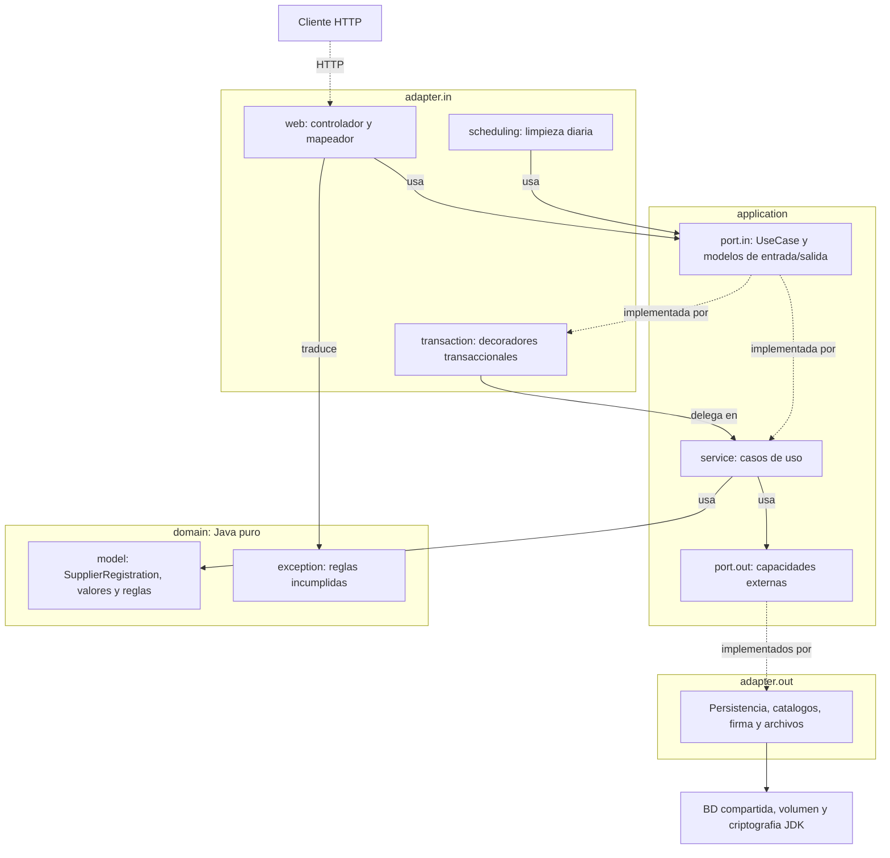

# Entrega — Registro de proveedores, primera etapa

Documento principal de la entrega. Generado el 2026-10-25 02:02 -0600 sobre el commit `8dd6108` de `main`. Cada número
sale de los comandos ejecutados en ese momento; su salida está en [evidencia/](evidencia/).

| Documento | Contenido |
| :--- | :--- |
| Este README | Alcance, ejecución, arquitectura, funcionalidades, decisiones, calidad, proceso y limitaciones. |
| [matriz-trazabilidad.md](matriz-trazabilidad.md) | RF → US → CA → INV → operationId → caso de uso → servicio → clases y métodos de prueba. |
| [evidencia/](evidencia/) | Salidas de [`spec_lint`](evidencia/spec_lint.txt) y [`spec_sync`](evidencia/spec_sync.txt), y el [resumen de pruebas](evidencia/surefire.md). |
| [docs/tecnica/](../tecnica/README.md) | Documentación técnica: arquitectura, API, dominio, operaciones, pruebas, decisiones y diagramas. |

## 1. Solución y alcance

Según la [visión](../../specs/vision.md), el registro permite que personas físicas y morales inicien y continúen su
registro como proveedores de la Plataforma de Compras de Fredkor Labs, identificándose con e.firma y capturando su
información por secciones.

**Incluido en la primera etapa** (visión §3): identificación con el componente externo de Firma Electrónica y
aceptación de la Política de Aviso; consulta de existencia sin altas duplicadas; inicio y reanudación del
expediente; Datos Generales con teléfonos y cédula fiscal; tipo de participación y partidas CUCoP; punto de
continuación hacia Contactos.

**Fuera de alcance** (visión §4): la implementación interna del componente de Firma Electrónica; la captura de
Contactos, Domicilio fiscal, Cobertura y Firma Electrónica final; la finalización del registro, la clave del
proveedor y el acuse; la administración del catálogo de proveedores.

La entrega es el **backend** (API REST). El frontend (`frontend/`) contiene la base de la plantilla Sakai; las
pantallas del registro no están implementadas (ver §8).

## 2. Cómo ejecutar

Detalle paso a paso en el [README raíz](../../README.md#cómo-ejecutar-el-backend) y en
[docs/tecnica/README.md](../tecnica/README.md#compilar-probar-y-ejecutar).

| Requisito | Versión o uso |
| :--- | :--- |
| Java | 25 (`backend/pom.xml`); Spring Boot 4.1.1. |
| Maven | Wrapper `backend/mvnw`; no hace falta instalarlo. |
| Docker | Obligatorio: PostgreSQL 17 local y Testcontainers en las pruebas (ADR-0017, ADR-0018). |
| Python 3 + PyYAML | Solo para `tools/spec_lint.py` y `tools/spec_sync.py`. |

1. **Base de datos:** contenedor `postgres:17` (README raíz, paso 1). Flyway aplica las migraciones al arrancar.
2. **Variables de entorno:** `REGISTRATION_DB_URL`, `REGISTRATION_DB_USERNAME`, `REGISTRATION_DB_PASSWORD`,
   `REGISTRATION_DOCUMENTS_ROOT` y, opcionales salvo con el perfil `prod`, `REGISTRATION_JWT_PRIVATE_KEY_LOCATION` y
   `REGISTRATION_JWT_PUBLIC_KEY_LOCATION`.
3. **Ejecutar:** `./mvnw spring-boot:run` desde `backend/`. API en `http://localhost:8080/api/v1`; Swagger UI con
   el contrato autoritativo en `http://localhost:8080/swagger-ui/index.html` (ADR-0008).
4. **Probar:** `./mvnw test` desde `backend/`, con Docker.
5. **Validar specs:** `python3 tools/spec_lint.py --require-ready` y `python3 tools/spec_sync.py` desde la raíz.
6. **Postman (opcional, ADR-0021):** [colección de contrato](../../postman/registro-proveedores-contrato.postman_collection.json)
   con las 22 operaciones y [colección de flujo](../../postman/registro-proveedores-flujo.postman_collection.json)
   con el ciclo de vida completo (`npx newman run … --env-var baseUrl=http://localhost:8080 --working-dir .`).

## 3. Arquitectura

Monolito con arquitectura hexagonal ([ADR-0001](../../specs/adr/0001-backend-arquitectura-hexagonal.md)). El dominio y la
aplicación son Java puro; los servicios se registran con `@Bean` y, cuando requieren transacción, se envuelven en un
decorador de `adapter.in.transaction`. Detalle, paquetes con sus clases y flujo de una petición en
[docs/tecnica/arquitectura.md](../tecnica/arquitectura.md); diagramas de secuencia por operación en
[docs/tecnica/diagramas.md](../tecnica/diagramas.md).

Persistencia en PostgreSQL 17 con Flyway (migraciones V1 a V18) e Hibernate en modo `validate`. Los documentos viven
en un volumen con limpieza diaria de los no asociados (ADR-0010). El acceso se protege con un JWT de 60 minutos y
contexto por `jti` (ADR-0015).

## 4. Funcionalidades

Estado según `spec_sync` y el conteo de pruebas `USxx_CAyyy` (ejecución de esta entrega). Contrato:
[OpenAPI](../../specs/api/supplier-registration-openapi.yaml), versión 0.2.1, 22 operaciones.

| Requerimiento | Historias | operationId | Estado |
| :--- | :--- | :--- | :--- |
| RF-REG-01: Identificar al solicitante mediante e.firma | [US01](../../specs/user-stories/US01-identificacion-mediante-efirma.md) | [`identifyApplicant`](../tecnica/operaciones/identifyApplicant.md) | Implementado y probado: 19/19 criterios de backend con prueba |
| RF-REG-02: Verificar la existencia del registro | [US02](../../specs/user-stories/US02-verificar-existencia-del-registro.md) | [`checkRegistrationExistence`](../tecnica/operaciones/checkRegistrationExistence.md) | Implementado y probado: 5/5 criterios de backend con prueba |
| RF-REG-03: Presentar y registrar aceptación del aviso | [US03](../../specs/user-stories/US03-aceptar-politicas.md) | [`getRegistrationNotice`](../tecnica/operaciones/getRegistrationNotice.md) [`acceptRegistrationNotice`](../tecnica/operaciones/acceptRegistrationNotice.md) [`identifyApplicant`](../tecnica/operaciones/identifyApplicant.md) | Implementado y probado: 6/6 criterios de backend con prueba |
| RF-REG-04: Iniciar expediente de registro | [US04](../../specs/user-stories/US04-crear-expediente-de-registro.md) | [`startSupplierRegistration`](../tecnica/operaciones/startSupplierRegistration.md) | Implementado y probado: 6/6 criterios de backend con prueba |
| RF-REG-05: Capturar, validar y guardar el registro por secciones | [US06](../../specs/user-stories/US06-navegar-y-guardar-secciones.md), [US08](../../specs/user-stories/US08-capturar-datos-generales.md), [US09](../../specs/user-stories/US09-capturar-telefonos-del-proveedor.md), [US10](../../specs/user-stories/US10-gestionar-cedula-fiscal.md), [US11](../../specs/user-stories/US11-capturar-participacion-y-partidas-cucop.md) | [`saveGeneralData`](../tecnica/operaciones/saveGeneralData.md) [`saveCucopParticipation`](../tecnica/operaciones/saveCucopParticipation.md) [`uploadFiscalDocument`](../tecnica/operaciones/uploadFiscalDocument.md) [`downloadFiscalDocument`](../tecnica/operaciones/downloadFiscalDocument.md) [`deleteFiscalDocument`](../tecnica/operaciones/deleteFiscalDocument.md) [`getTaxRegimes`](../tecnica/operaciones/getTaxRegimes.md) [`getCountries`](../tecnica/operaciones/getCountries.md) [`getLegalOwnerships`](../tecnica/operaciones/getLegalOwnerships.md) [`getSectors`](../tecnica/operaciones/getSectors.md) [`getSubsectors`](../tecnica/operaciones/getSubsectors.md) [`getBusinessActivities`](../tecnica/operaciones/getBusinessActivities.md) [`getStratifications`](../tecnica/operaciones/getStratifications.md) [`getPrimaryActivities`](../tecnica/operaciones/getPrimaryActivities.md) [`getWorkerCountRanges`](../tecnica/operaciones/getWorkerCountRanges.md) [`getAnnualSalesRanges`](../tecnica/operaciones/getAnnualSalesRanges.md) | Implementado y probado: 45/45 criterios de backend con prueba |
| RF-REG-06: Reanudar un expediente incompleto | [US05](../../specs/user-stories/US05-reanudar-expediente-incompleto.md) | [`resumeSupplierRegistration`](../tecnica/operaciones/resumeSupplierRegistration.md) | Implementado y probado: 10/10 criterios de backend con prueba |
| RF-REG-07: Finalizar el registro | [US07](../../specs/user-stories/US07-finalizar-registro.md) | — | Etapa posterior: sin operación ni implementación |
| RF-REG-08: Capturar tipo de participación y partidas CUCoP | [US11](../../specs/user-stories/US11-capturar-participacion-y-partidas-cucop.md) | [`saveCucopParticipation`](../tecnica/operaciones/saveCucopParticipation.md) [`getCucopCatalog`](../tecnica/operaciones/getCucopCatalog.md) | Implementado y probado: 5/5 criterios de backend con prueba |

Además, la limpieza diaria de archivos no asociados (`CleanUpUnassociatedFilesUseCase`, RNF-04 y ADR-0010) está
implementada y probada; no es una operación del contrato.

## 5. Decisiones de arquitectura

| ADR | Ámbito | Decisión | Estado |
| :--- | :--- | :--- | :--- |
| [ADR-0001](../../specs/adr/0001-backend-arquitectura-hexagonal.md) | Backend | Arquitectura hexagonal y modelos por frontera | Aceptado |
| [ADR-0002](../../specs/adr/0002-shared-transiciones-como-acciones.md) | Compartido | Acciones de registro y guardado explícito por sección | Aceptado |
| [ADR-0003](../../specs/adr/0003-shared-identificador-uuid.md) | Compartido | UUID del expediente y RFC como identidad de negocio | Aceptado |
| [ADR-0004](../../specs/adr/0004-shared-codigos-de-error.md) | Compartido | Errores del registro y representación HTTP | Aceptado |
| [ADR-0005](../../specs/adr/0005-backend-base-de-datos-h2.md) | Backend | H2 en memoria para pruebas y pérdida de referencias al reiniciar | Reemplazado por ADR-0018 |
| [ADR-0006](../../specs/adr/0006-backend-spring-boot-4.md) | Backend | Stack backend con Spring Boot 4.1 y Java 25 | Aceptado |
| [ADR-0007](../../specs/adr/0007-backend-error-interno-generico.md) | Backend | Error interno genérico sin detalles de infraestructura | Aceptado |
| [ADR-0008](../../specs/adr/0008-backend-swagger-ui-con-contrato.md) | Backend | Swagger UI con contrato autoritativo del registro | Aceptado |
| [ADR-0009](../../specs/adr/0009-shared-null-explicito-en-requests.md) | Compartido | Campos requeridos, opcionales y guardado completo de secciones | Aceptado |
| [ADR-0010](../../specs/adr/0010-backend-almacenamiento-documental-en-volumen.md) | Backend | Servicio general de archivos, asociación inmediata, eliminación lógica y limpieza diaria | Aceptado |
| [ADR-0011](../../specs/adr/0011-frontend-angular-21.md) | Frontend | Frontend con Angular 21 | Aceptado |
| [ADR-0012](../../specs/adr/0012-frontend-primeng-sakai.md) | Frontend | PrimeNG y plantilla Sakai para Angular 21 | Aceptado |
| [ADR-0013](../../specs/adr/0013-frontend-arquitectura-por-dominios.md) | Frontend | Arquitectura frontend por dominios: DDD / Nx Style | Aceptado |
| [ADR-0014](../../specs/adr/0014-frontend-formularios-reactivos.md) | Frontend | Preferencia por formularios reactivos de Angular | Aceptado |
| [ADR-0015](../../specs/adr/0015-shared-token-de-registro.md) | Compartido | JWT de registro de 60 minutos y sesiones concurrentes por solicitante | Aceptado |
| [ADR-0016](../../specs/adr/0016-backend-verificacion-firma-sha256-rsa.md) | Backend | Verificación RSA PKCS#1 v1.5 con SHA-256 y Java SHA256withRSA | Aceptado |
| [ADR-0017](../../specs/adr/0017-backend-postgresql-persistencia-duradera.md) | Backend | PostgreSQL 17 con Flyway para persistencia duradera | Aceptado |
| [ADR-0018](../../specs/adr/0018-backend-postgresql-en-pruebas-y-desarrollo.md) | Backend | PostgreSQL en pruebas y desarrollo con base de pruebas desechable | Aceptado |
| [ADR-0019](../../specs/adr/0019-shared-problem-details-rfc-9457.md) | Compartido | Errores como Problem Details (RFC 9457) | Aceptado |
| [ADR-0020](../../specs/adr/0020-shared-catalogos-por-recurso.md) | Compartido | Un recurso por catálogo de Datos Generales | Aceptado |
| [ADR-0021](../../specs/adr/0021-backend-colecciones-postman.md) | Backend | Colecciones Postman como verificación complementaria | Aceptado |

## 6. Calidad

| Comprobación | Resultado de esta entrega |
| :--- | :--- |
| `python3 tools/spec_lint.py --require-ready` | RESULTADO: OK — coherencia documental; no valida ejecución |
| `python3 tools/spec_sync.py --md docs/sync-report.md` | RESULTADO: OK - specs e implementación sincronizadas (Operaciones: 22 · Criterios de aceptación: 136 (91 verificables en backend) · Pruebas USxx_CAyyy: 403; advertencias: 0) |
| `./mvnw clean test` | `BUILD SUCCESS`: 83 clases, 646 pruebas, 0 fallos, 0 errores, 0 omitidas. |
| Criterios de aceptación | 136 en total; 91 verificables en backend según [`traceability.md`](../../specs/traceability.md#3-cobertura-de-criterios-de-aceptación); **91 de 91** con al menos una prueba. |

Pruebas por capa (de `backend/target/surefire-reports`; detalle en [evidencia/surefire.md](evidencia/surefire.md)):

| Capa | Clases | Pruebas | Fallos + errores |
| :--- | :--- | :--- | :--- |
| Dominio | 12 | 115 | 0 |
| Aplicación | 23 | 117 | 0 |
| Adaptadores de entrada | 8 | 104 | 0 |
| Adaptadores de salida | 8 | 112 | 0 |
| Integración (aplicación completa) | 31 | 196 | 0 |
| Configuración | 1 | 2 | 0 |

Las pruebas de dominio son JUnit puro; las de aplicación usan dobles de los puertos; las de adaptadores de salida e
integración usan un PostgreSQL 17 desechable (Testcontainers). Estrategia completa en
[docs/tecnica/pruebas.md](../tecnica/pruebas.md).

## 7. Proceso SDD seguido

Las specs de `specs/` definen el comportamiento y el código las implementa ([CLAUDE.md](../../CLAUDE.md)). Fases:

1. **Especificar:** visión, RF/RNF, historias con criterios, catálogos y ciclo de vida (`spec:`).
2. **Diseñar:** modelo de dominio con INV-01 a INV-39, arquitectura, diseño de base de datos y ADR (`design:`).
3. **Contrato:** OpenAPI marcado `READY`, del que Maven genera interfaces y DTO (`contract:`).
4. **Implementar** operación por operación con `/implementar`, con pruebas `USxx_CAyyy` (`feat:`).
5. **Verificar y corregir:** `/sincronizar` ([revisiones](../revisiones/)), `/diagramas`, `/refactorizar`,
   correcciones (`fix:`, `test:`, `refactor:`) y cambios de spec con `/cambio-spec`
   ([CHANGELOG](../../specs/CHANGELOG.md)).
6. **Documentar:** `/documentar` ([docs/tecnica/](../tecnica/README.md)) y esta entrega (`docs:`).

Historial de git (2026-10-19 a 2026-10-25, antes del commit de esta entrega): 116 commits sin contar fusiones y
37 fusiones de PR.

| Prefijo | Commits | Uso |
| :--- | :--- | :--- |
| `spec:` | 23 | Negocio: visión, RF, historias, criterios, catálogos y ciclo de vida. |
| `design:` | 20 | Arquitectura, modelo de dominio y ADR. |
| `contract:` | 8 | Contrato OpenAPI. |
| `feat:` | 25 | Implementación de una operación con sus pruebas. |
| `fix:` | 9 | Corrección del código para cumplir la spec. |
| `test:` | 5 | Pruebas agregadas o renombradas. |
| `refactor:` | 1 | Estructura nueva con el mismo comportamiento. |
| `tooling:` | 4 | `tools/` y validadores. |
| `docs:` | 10 | Documentación derivada: README, `docs/`, Postman. |
| `chore:` | 1 | Mantenimiento del repositorio. |
| otros | 10 | Commits iniciales sin el prefijo convenido (configuración, frontend base, herramientas). |

## 8. Limitaciones conocidas y trabajo futuro

- **Frontend:** las pantallas del registro no existen. ADR-0011 a ADR-0014 fijan Angular 21, PrimeNG/Sakai,
  organización por dominios y formularios reactivos. Los 45 criterios no verificables en
  backend (interfaz, integración externa o etapa posterior) quedan sin prueba automatizada.
- **Etapa posterior:** Contactos, Domicilio fiscal, Cobertura, Firma final y finalización (RF-REG-07, US07,
  INV-38 e INV-39) requieren especificaciones antes de implementarse.
- **Requerimientos no funcionales pendientes de medir o acordar**
  ([no-functional.md, objetivos cuantitativos pendientes](../../specs/requirements/no-functional.md#objetivos-cuantitativos-pendientes)):
  rendimiento (plan de pruebas para los umbrales aprobados en RNF-06), disponibilidad (monitoreo para el 99.5 % de
  RNF-11), recuperación (tecnología y procedimiento de respaldos para RPO 24 h y RTO 4 h de RNF-05), capacidad
  (volumen y crecimiento de archivos) y entorno cliente (RNF-12 y RNF-13, sin frontend todavía).
- **Advertencias de `spec_sync`:** 0.
- **Postman:** la colección de contrato se generó antes de los ejemplos del contrato 0.2.1; regenerarla en Postman
  la actualiza (no se edita a mano).

## 9. Etiqueta propuesta

`etapa-1`, sobre el commit que fusione esta entrega en `main`. No se usa `vX.Y.Z`: esa numeración es la de
`info.version` del contrato ([API-GUIDELINES](../../specs/api/API-GUIDELINES.md#versionado-del-contrato)).
