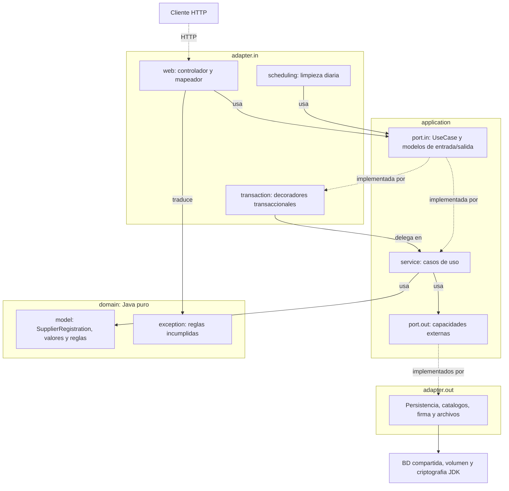

<!-- Generado con /documentar desde specs/ y backend/src/. No editar a mano: cambia la spec y regenera. -->

# Arquitectura

Resume [architecture.md](../../specs/architecture/architecture.md) y
[ADR-0001](../../specs/adr/0001-backend-arquitectura-hexagonal.md) con las clases reales de
`backend/src/main/java/mx/com/fredkorlabs/registration`. Los diagramas de componentes y de secuencia por operación
están en [diagramas.md](diagramas.md).

## Capas y regla de dependencia

Monolito con arquitectura hexagonal: dominio, aplicación y adaptadores. El diagrama es el de
[architecture.md §3](../../specs/architecture/architecture.md#3-capas-y-regla-de-dependencia):

- Las flechas punteadas son realización, no dependencias hacia los adaptadores.
- `domain` y `application` son Java puro: sin Spring, JPA, Jackson ni tipos HTTP. Los servicios no llevan
  `@Service`, `@Component` ni `@Transactional`; `configuration` los registra con `@Bean` y, cuando el caso de uso
  necesita transacción, los envuelve en un decorador de `adapter.in.transaction`
  ([§7](../../specs/architecture/architecture.md#7-coordinación-y-transacciones)).
- La tabla de dependencias permitidas y excluidas por paquete está en
  [architecture.md §3](../../specs/architecture/architecture.md#3-capas-y-regla-de-dependencia);
  `tools/spec_sync.py` comprueba la regla de dependencia sobre los `import`.

## Modelos por frontera

Según [architecture.md §4](../../specs/architecture/architecture.md#4-modelos-por-frontera), cada frontera
convierte a su propio modelo:

| Frontera | Modelos reales | Conversión |
| :--- | :--- | :--- |
| HTTP | Interfaces `*Api` y DTO de `adapter.in.web.generated` (Maven, desde el contrato) | El controlador traduce DTO ↔ Command/Query/Result; nunca escribe DTO a mano. |
| Entrada de aplicación | `*Command`, `*Query`, `*Result` (`record`) y excepciones de aplicación de `application.port.in` | Sin `MultipartFile`, `ResponseEntity` ni entidades JPA. |
| Dominio | `SupplierRegistration`, `ApplicantIdentity`, `GeneralData`, `PhoneNumber`, `CucopParticipation`, `SectionProgress`, `FiscalIdentificationDocument`, `ApplicantSignatureEvidence` | Nunca llega al controlador. |
| Salida de aplicación | Modelos de `application.port.out` (`StoredRegistration`, `RegistrationSession`, `StoredFileMetadata`, `CatalogRecord`, …) | Los adaptadores los construyen; no dependen de `port.in`. |
| Persistencia | `*JpaEntity` y repositorios de `adapter.out.persistence` y `adapter.out.catalog` | El adaptador reconstituye el dominio (`SupplierRegistration.reconstitute`) sin ejecutar transiciones. |
| Firma | `SignatureResultInput` (resultado íntegro y proyecciones) | El web conserva el JSON original de `signatureResult` sin re-serializar. |
| Documento | Bytes y metadatos en aplicación; `StoredDocumentReference` en dominio | El dominio no contiene bytes, rutas ni streams. |

## Paquetes y clases reales

Recorrido de `backend/src/main/java/mx/com/fredkorlabs/registration` (estructura prevista en
[architecture.md §9](../../specs/architecture/architecture.md#9-estructura-prevista)):

| Paquete | Clases | Clases reales |
| :--- | :--- | :--- |
| `(raíz)` | 1 | `SupplierRegistrationApplication` |
| `adapter.in.scheduling` | 1 | `DailyFileCleanupScheduler` |
| `adapter.in.transaction` | 10 | `TransactionalAcceptRegistrationNoticeUseCase`, `TransactionalCleanUpUnassociatedFilesUseCase`, `TransactionalDeleteFiscalDocumentUseCase`, `TransactionalDownloadFiscalDocumentUseCase`, `TransactionalIdentifyApplicantUseCase`, `TransactionalResumeSupplierRegistrationUseCase`, `TransactionalSaveCucopParticipationUseCase`, `TransactionalSaveGeneralDataUseCase`, `TransactionalStartSupplierRegistrationUseCase`, `TransactionalUploadFiscalDocumentUseCase` |
| `adapter.in.web` | 21 | `ApplicantIdentificationsController`, `EditableTextFields`, `FiscalDocumentsController`, `GlobalExceptionHandler`, `InvalidRequestParameterException`, `JsonPointers`, `MissingRequestPropertyException`, `MultipartParts`, `ProblemErrorController`, `ProblemResponses`, `QueryParameters`, `RawJsonProperty`, `RawRequestBodyAdvice`, `RegistrationCatalogsController`, `RegistrationNoticesController`, `RegistrationTokenAuthenticationEntryPoint`, `RegistrationTokenPrincipal`, `RepeatedRequestItemException`, `RequestPropertyPresence`, `RequestUniqueItems`, `SupplierRegistrationsController` |
| `adapter.out.catalog` | 30 | `AnnualSalesRangeJpaEntity`, `AnnualSalesRangeJpaRepository`, `BusinessActivityJpaEntity`, `BusinessActivityJpaRepository`, `CountryJpaEntity`, `CountryJpaRepository`, `CucopCatalogAdapter`, `CucopChapterJpaEntity`, `CucopChapterJpaRepository`, `CucopConceptJpaEntity`, `CucopConceptJpaRepository`, `CucopGenericItemJpaEntity`, `CucopGenericItemJpaRepository`, `CucopSpecificItemJpaEntity`, `CucopSpecificItemJpaRepository`, `GeneralDataCatalogAdapter`, `LegalOwnershipJpaEntity`, `LegalOwnershipJpaRepository`, `PrimaryActivityJpaEntity`, `PrimaryActivityJpaRepository`, `SectorJpaEntity`, `SectorJpaRepository`, `StratificationJpaEntity`, `StratificationJpaRepository`, `SubsectorJpaEntity`, `SubsectorJpaRepository`, `TaxRegimeJpaEntity`, `TaxRegimeJpaRepository`, `WorkerCountRangeJpaEntity`, `WorkerCountRangeJpaRepository` |
| `adapter.out.document` | 1 | `VolumeFileStorageAdapter` |
| `adapter.out.persistence` | 22 | `ApplicantSignatureEvidenceJpaEntity`, `ApplicantSignatureEvidenceJpaRepository`, `ApplicantSignatureEvidencePersistenceAdapter`, `CucopParticipationJpaEntity`, `CucopParticipationJpaRepository`, `FileMetadataJpaEntity`, `FileMetadataJpaRepository`, `FileMetadataPersistenceAdapter`, `GeneralDataJpaEntity`, `GeneralDataJpaRepository`, `NoticeAcceptanceJpaEntity`, `NoticeAcceptanceJpaRepository`, `NoticeAcceptancePersistenceAdapter`, `PhoneEmbeddable`, `RegistrationContextAdapter`, `RegistrationContextJpaEntity`, `RegistrationContextJpaRepository`, `RegistrationFiscalDocumentJpaEntity`, `RegistrationFiscalDocumentJpaRepository`, `SupplierRegistrationJpaEntity`, `SupplierRegistrationJpaRepository`, `SupplierRegistrationPersistenceAdapter` |
| `adapter.out.signature` | 2 | `JdkApplicantSignatureVerificationAdapter`, `X500SubjectReader` |
| `application.port.in` | 57 | `AcceptRegistrationNoticeCommand`, `AcceptRegistrationNoticeResult`, `AcceptRegistrationNoticeUseCase`, `CatalogOptionsResult`, `CheckRegistrationExistenceQuery`, `CheckRegistrationExistenceResult`, `CheckRegistrationExistenceUseCase`, `CleanUpUnassociatedFilesResult`, `CleanUpUnassociatedFilesUseCase`, `DeleteFiscalDocumentCommand`, `DeleteFiscalDocumentUseCase`, `DownloadFiscalDocumentQuery`, `DownloadFiscalDocumentResult`, `DownloadFiscalDocumentUseCase`, `FiscalDocumentNotFoundException`, `GetAnnualSalesRangesUseCase`, `GetBusinessActivitiesUseCase`, `GetCountriesResult`, `GetCountriesUseCase`, `GetCucopCatalogResult`, `GetCucopCatalogUseCase`, `GetLegalOwnershipsQuery`, `GetLegalOwnershipsResult`, `GetLegalOwnershipsUseCase`, `GetPrimaryActivitiesUseCase`, `GetRegistrationNoticeResult`, `GetRegistrationNoticeUseCase`, `GetSectorsUseCase`, `GetStratificationsUseCase`, `GetSubsectorsQuery`, `GetSubsectorsUseCase`, `GetTaxRegimesUseCase`, `GetWorkerCountRangesUseCase`, `IdentifyApplicantCommand`, `IdentifyApplicantResult`, `IdentifyApplicantUseCase`, `InvalidIdentificationDataException`, `InvalidQueryParameterException`, `RegistrationAccessDeniedException`, `RegistrationAlreadyExistsException`, `RegistrationNotFoundException`, `RegistrationSessionUnavailableException`, `ResumeSupplierRegistrationCommand`, `ResumeSupplierRegistrationUseCase`, `SaveCucopParticipationCommand`, `SaveCucopParticipationUseCase`, `SaveGeneralDataCommand`, `SaveGeneralDataUseCase`, `SectionSaveResult`, `SignatureResultInput`, `SignatureVerificationFailedException`, `StartSupplierRegistrationCommand`, `StartSupplierRegistrationUseCase`, `SupplierRegistrationResult`, `UploadFiscalDocumentCommand`, `UploadFiscalDocumentResult`, `UploadFiscalDocumentUseCase` |
| `application.port.out` | 23 | `ApplicantSignatureEvidencePersistencePort`, `ApplicantSignatureVerificationPort`, `CatalogRecord`, `CountryRecord`, `CucopCatalog`, `CucopCatalogPort`, `DuplicateRegistrationException`, `FileMetadataPort`, `FileStoragePort`, `FiscalDocumentView`, `GeneralDataCatalogPort`, `GeneralDataSelection`, `NoticeAcceptanceAlreadyUsedException`, `NoticeAcceptancePersistencePort`, `NoticeAcceptanceReference`, `RegistrationContextPort`, `RegistrationSession`, `RegistrationStatusView`, `SignatureCheck`, `SignatureEvidenceReference`, `StoredFileMetadata`, `StoredRegistration`, `SupplierRegistrationPersistencePort` |
| `application.service` | 25 | `AcceptRegistrationNoticeService`, `CheckRegistrationExistenceService`, `CleanUpUnassociatedFilesService`, `DeleteFiscalDocumentService`, `DownloadFiscalDocumentService`, `GetAnnualSalesRangesService`, `GetBusinessActivitiesService`, `GetCountriesService`, `GetCucopCatalogService`, `GetLegalOwnershipsService`, `GetPrimaryActivitiesService`, `GetRegistrationNoticeService`, `GetSectorsService`, `GetStratificationsService`, `GetSubsectorsService`, `GetTaxRegimesService`, `GetWorkerCountRangesService`, `IdentifyApplicantService`, `OwnedRegistration`, `ResumeSupplierRegistrationService`, `SaveCucopParticipationService`, `SaveGeneralDataService`, `StartSupplierRegistrationService`, `SupplierRegistrationResults`, `UploadFiscalDocumentService` |
| `configuration` | 11 | `ApplicantIdentificationConfiguration`, `ClockConfiguration`, `FiscalDocumentConfiguration`, `JacksonConfiguration`, `JwtKeyConfiguration`, `RegistrationCatalogConfiguration`, `RegistrationDocumentsProperties`, `RegistrationJwtProperties`, `RegistrationNoticeConfiguration`, `SecurityConfiguration`, `SupplierRegistrationConfiguration` |
| `domain.exception` | 16 | `ApplicantRfcMismatchException`, `DocumentFormatNotSupportedException`, `DocumentTooLargeException`, `FiscalDocumentAlreadyExistsException`, `FiscalDocumentRequiredException`, `InvalidCertificateIdentityException`, `InvalidCucopParticipationException`, `InvalidForeignFiscalCodeException`, `InvalidGeneralDataException`, `InvalidNationalityException`, `InvalidNoticeVersionException`, `InvalidPhoneNumberException`, `InvalidRegistrationStateException`, `InvalidRfcException`, `InvalidWebsiteException`, `RegistrationDomainException` |
| `domain.model` | 34 | `ApplicantIdentity`, `ApplicantSignatureEvidence`, `CertificateIdentity`, `CertificateSubjectAttribute`, `CucopChapter`, `CucopConcept`, `CucopGenericItem`, `CucopParticipation`, `CucopParticipationViolation`, `CucopSpecificItem`, `FiscalDocumentFormat`, `FiscalIdentificationDocument`, `ForeignFiscalCode`, `GeneralData`, `GeneralDataCatalogContext`, `GeneralDataInput`, `GeneralDataViolation`, `LegalOwnershipOption`, `Nationality`, `NoticeAcceptance`, `Origin`, `ParticipationType`, `PhoneNumber`, `RegistrationSection`, `RegistrationStatus`, `Rfc`, `SectionProgress`, `SectionStatus`, `StoredDocumentReference`, `SupplierRegistration`, `SupplierRegistrationId`, `TaxRegime`, `Username`, `Website` |
| `adapter.in.web.generated` | 5 | `ApplicantIdentificationsApi`, `FiscalDocumentsApi`, `RegistrationCatalogsApi`, `RegistrationNoticesApi`, `SupplierRegistrationsApi` (generadas por Maven en `target/`) |
| `adapter.in.web.generated.model` | 35 | `AcceptRegistrationNoticeRequest`, `ApplicantIdentificationResponse`, `ApplicantIdentityResponse`, `CatalogOptionListResponse`, `CatalogOptionResponse`, `CountryOptionListResponse`, `CountryOptionResponse`, `CucopCatalogResponse`, `CucopNodeResponse`, `CucopParticipationRequest`, `CucopParticipationResponse`, `CucopTreeNodeResponse`, `ErrorCode`, `FiscalDocumentResponse`, `GeneralDataRequest`, `GeneralDataResponse`, `IdentifyApplicantRequest`, `LegalOwnershipOptionListResponse`, `LegalOwnershipOptionResponse`, `NoticeAcceptanceResponse`, `Origin`, `ParticipationType`, `PhoneRequest`, `ProblemFieldErrorResponse`, `ProblemResponse`, `RegistrationExistenceResponse`, `RegistrationNoticeResponse`, `RegistrationSection`, `RegistrationStatus`, `SectionProgressResponse`, `SectionSaveResponse`, `SectionStatus`, `SignatureResultRequest`, `SupplierRegistrationResponse`, `TaxRegime` (generados por Maven en `target/`) |

## Flujo de una petición: `saveGeneralData`

Request → Command → `SupplierRegistration` → entidad JPA → Result → Response, con las clases que intervienen.
La secuencia completa, con errores, está en [diagramas.md §4.4](diagramas.md#44-savegeneraldata) y en
[architecture.md §8](../../specs/architecture/architecture.md#8-diagrama-de-secuencia-guardar-datos-generales).

| Paso | Clase | Paquete | Qué ocurre |
| :--- | :--- | :--- | :--- |
| 1. Request | `GeneralDataRequest` (DTO generado) | `adapter.in.web.generated.model` | Jackson deserializa; `RawRequestBodyAdvice` recorta textos y exige presencia de propiedades (ADR-0009). |
| 2. Command | `SaveGeneralDataCommand` | `application.port.in` | `SupplierRegistrationsController` traduce el DTO y añade el `jti` del token (`RegistrationTokenPrincipal`). |
| 3. Transacción | `TransactionalSaveGeneralDataUseCase` | `adapter.in.transaction` | Abre la transacción y delega en el servicio (§7). |
| 4. Aplicación | `SaveGeneralDataService` | `application.service` | Resuelve sesión y expediente bloqueado (`OwnedRegistration`) y los catálogos (`GeneralDataCatalogPort`). |
| 5. Dominio | `GeneralData.validate`, `SupplierRegistration.saveGeneralData` | `domain.model` | Valida la sección, exige la cédula asociada y marca GENERAL_DATA COMPLETED. |
| 6. Entidad JPA | `GeneralDataJpaEntity`, `PhoneEmbeddable`, `SupplierRegistrationJpaEntity` | `adapter.out.persistence` | `SupplierRegistrationPersistenceAdapter` sustituye datos y teléfonos y actualiza el progreso. |
| 7. Result | `SectionSaveResult` | `application.port.in` | Sección, estado y siguiente sección, sin tipos de dominio. |
| 8. Response | `SectionSaveResponse` (DTO generado) | `adapter.in.web.generated.model` | El controlador la construye; 200 tras el commit. |

Los errores se traducen en `GlobalExceptionHandler` a Problem Details
([ADR-0019](../../specs/adr/0019-shared-problem-details-rfc-9457.md)) con el HTTP y el `code` de
[ADR-0004](../../specs/adr/0004-shared-codigos-de-error.md).
