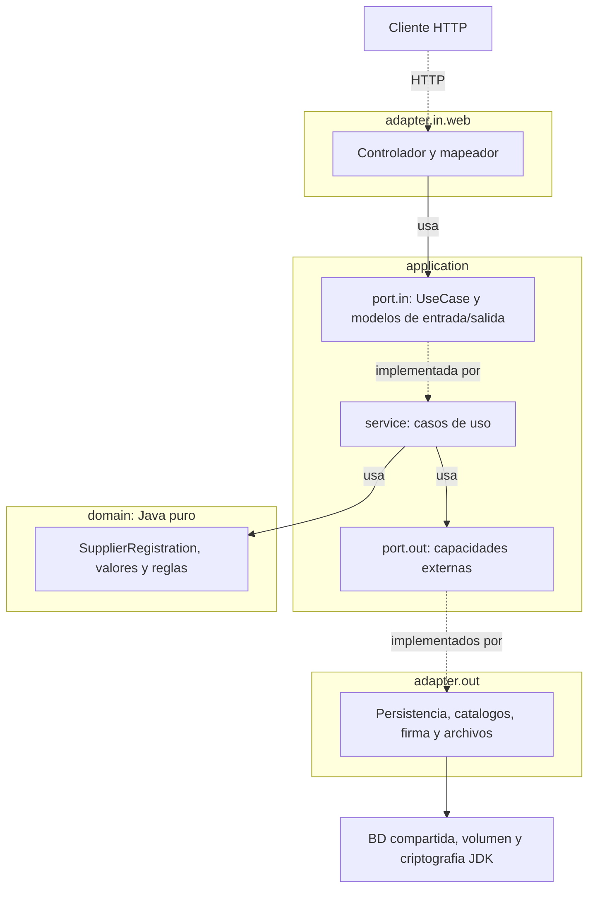
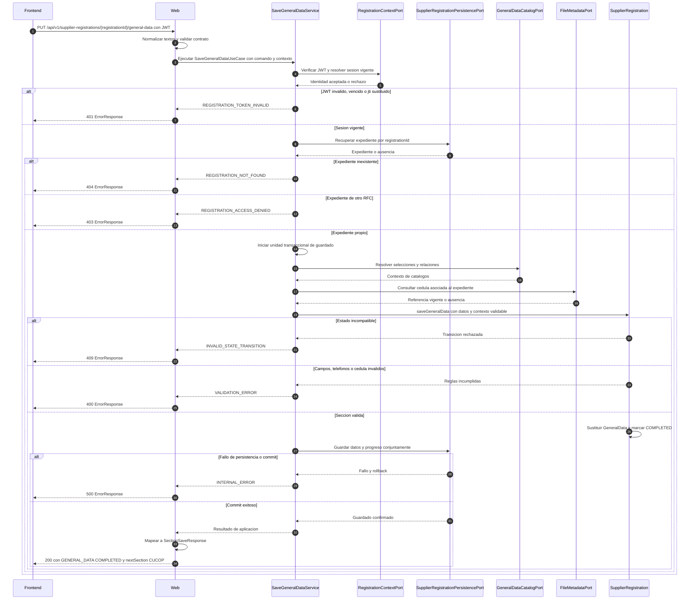

# Arquitectura — Registro de proveedores de Fredkor Labs

## 1. Estilo y alcance

La solución es una aplicación monolítica con arquitectura hexagonal: dominio, aplicación y
adaptadores. Mantiene la separación de responsabilidades de ADR-0001 y representa el
[modelo de dominio](domain-model.md), sus 39 reglas y el
[ciclo de vida](../domain/supplier-registration-lifecycle.md).

La primera etapa cubre aceptación del aviso, identificación, consulta de existencia, inicio
y reanudación del expediente, Datos Generales, teléfonos, cédula fiscal y CUCoP. Contactos
es el punto de continuación; la captura de secciones posteriores y la finalización están
fuera de esta etapa.

Las tecnologías y versiones se documentan en [tech-stack.md](tech-stack.md) y `pom.xml`.
Este documento no agrega dependencias ni cambia versiones. Las decisiones de infraestructura
pendientes se resolverán mediante ADR antes de implementar el adaptador afectado.

## 2. Componentes y límites

| Componente | Responsabilidad | Relación con el backend |
| :--- | :--- | :--- |
| Interfaz de registro | Presentar aviso y asistente; valores de solo lectura, dependencias, tabla de teléfonos, carga documental y selección CUCoP. | Invoca los casos de uso expuestos por el adaptador web. No accede directamente a persistencia. |
| Componente externo de Firma Electrónica del solicitante | Gestionar archivos y contraseña, comprobar vigencia y OCSP y firmar la cadena `Temporal`. | Su resultado se envía al backend para verificación y procesamiento. Su implementación queda fuera del alcance. |
| Aplicación de registro | Coordinar identificación aceptada, expediente, acceso por RFC, catálogos, secciones y documentos. | Orquesta dominio y puertos de salida. |
| Dominio | Identidad, reglas condicionales, participación, expediente y condiciones de avance. | Java puro, sin HTTP, JPA ni llamadas al componente de firma. |
| Adaptadores de salida | Persistencia, consulta de catálogos, verificación del sello y almacenamiento de documentos. | Implementan las capacidades requeridas por aplicación. |

El componente de firma se utiliza desde la interfaz. El backend no solicita al usuario su
llave privada ni contraseña, no vuelve a firmar y no repite las verificaciones OCSP del
componente. Verifica el sello sobre el contenido firmado con el certificado del solicitante.

El frontend utiliza Angular 21, PrimeNG y la plantilla Sakai conforme a
[ADR-0011](../adr/0011-frontend-angular-21.md) y [ADR-0012](../adr/0012-frontend-primeng-sakai.md).
El árbol CUCoP utiliza PrimeNG Tree sin trasladar sus nodos o eventos al modelo de dominio.
La estructura por dominios DDD / Nx Style se define en
[ADR-0013](../adr/0013-frontend-arquitectura-por-dominios.md), sin obligar a instalar Nx.
Se prefieren formularios reactivos según
[ADR-0014](../adr/0014-frontend-formularios-reactivos.md). Estas decisiones no cambian las
reglas de navegación, guardado, firma o selección ya especificadas.

## 3. Capas y regla de dependencia



Las flechas `implementada por` e `implementados por` indican realización, no dependencias
hacia los adaptadores. El grupo de salida resume varios adaptadores independientes, detallados
en la tabla. El controlador usa `port.in`; los servicios usan dominio y `port.out`.
El dominio solo conoce el JDK y sus propios tipos.

| Paquete | Responsabilidad | Dependencias permitidas | Dependencias excluidas |
| :--- | :--- | :--- | :--- |
| `domain.model` | Agregados, entidades, objetos de valor y enums del modelo. | JDK y otros tipos de dominio. | Spring, JPA, HTTP, aplicación, adaptadores, librerías del componente de firma. |
| `domain.exception` | Incumplimientos de reglas de dominio. | JDK. | Códigos HTTP y clases de infraestructura. |
| `application.port.in` | Interfaces de casos de uso; Commands, Queries y Results. | JDK y tipos de aplicación; dominio solo si es necesario sin exponerlo al adaptador web. | Servicios concretos y adaptadores. |
| `application.port.out` | Capacidades externas y sus modelos de intercambio. | JDK y dominio. | Adaptadores y resultados propios de `port.in`. |
| `application.service` | Implementar casos de uso, resolver contexto, autorizar acceso, coordinar transacciones y puertos. | Dominio, `port.in`, `port.out`; Spring para integración y transacciones. | Implementaciones concretas de adaptadores. |
| `adapter.in.web` | Traducir HTTP y archivos a entradas de aplicación; mapear resultados y errores. | `application.port.in`; excepciones de dominio solo para traducir errores. | Agregados de dominio, servicios concretos, JPA y adaptadores de salida. |
| `adapter.out.persistence` | Guardar y reconstruir expedientes, aceptaciones, evidencias y asociaciones documentales. | `application.port.out`, dominio y JPA. | Controladores y modelos web. |
| `adapter.out.catalog` | Resolver registros y relaciones de catálogos existentes. | `application.port.out`, dominio y tecnología de consulta elegida. | Interfaz y casos de uso de entrada. |
| `adapter.out.signature` | Verificar criptográficamente sello, contenido y certificado; traducir el resultado externo. | `application.port.out`, dominio y mecanismo criptográfico elegido. | Interfaz, servicios concretos y acceso directo a sus transacciones. |
| `adapter.out.document` | Gestionar contenido de archivos de cualquier tipo admitido mediante referencias opacas. | `application.port.out` y tecnología de almacenamiento elegida. | Agregados completos, interfaz y controladores. |

Las dependencias se inyectan por constructor. El controlador conoce los puertos de entrada;
el servicio conoce los puertos de salida. El ensamblaje de implementaciones ocurre en el
arranque de la aplicación, sin trasladar reglas de negocio a la configuración.

## 4. Modelos por frontera

| Frontera | Modelos | Regla |
| :--- | :--- | :--- |
| HTTP | Interfaces y DTO generados desde OpenAPI. | El borrador define rutas y operationId; generación pendiente de validar y alinear herramientas. No duplicar DTO manualmente. |
| Entrada de aplicación | Commands, Queries y Results, preferentemente `record`. | No contienen `MultipartFile`, entidades JPA, `ResponseEntity` ni objetos del componente visual. |
| Dominio | `SupplierRegistration`, `ApplicantIdentity`, `GeneralData`, `PhoneNumber`, `CucopParticipation`, `SectionProgress` y tipos documentales y de evidencia. | No se devuelven directamente al controlador. |
| Persistencia | Entidades y mapeadores propios del adaptador. | Reconstituyen el dominio sin ejecutar el alta ni nuevas transiciones. |
| Firma del solicitante | Resultado completo del componente y proyección de sus campos conocidos. | Se conserva íntegro el resultado aceptado. El mapeo de nombres externos a nombres internos no debe perder propiedades. |
| Documento | Contenido y metadatos en modelos de aplicación; referencia opaca `StoredDocumentReference` en dominio. | El adaptador web traduce el archivo y el adaptador documental gestiona su almacenamiento; el dominio no contiene bytes, rutas ni streams. |
| Catálogos | Referencias y registros con datos y relaciones necesarios para validar. | La aplicación no usa DTO web como modelo de catálogo. |

`SignatureResultInput` representa el resultado completo recibido para identificación,
con sus proyecciones de contenido, RFC, razón social, sello y certificado. Sus campos están definidos en el borrador OpenAPI. El dominio y los puertos no dependen de Jackson ni de una clase
externa del componente de firma.

Los resultados de aplicación proyectan estado, identidad, datos guardados y progreso sin
exponer las entidades. Conservar toda la evidencia no implica devolver su contenido completo
en cada consulta del expediente.

## 5. Puertos de entrada y servicios

Los nombres siguientes definen responsabilidades de aplicación. Las firmas concretas y los
campos de Commands, Queries y Results se cerrarán con el contrato API. Las referencias US
corresponden a los archivos de historias, cuyos encabezados conservan HU-REG.

| Puerto de entrada | Entrada / salida conceptual | Servicio | Fuente |
| :--- | :--- | :--- | :--- |
| `GetRegistrationNoticeUseCase` | Consulta → contenido y versión vigente del aviso. | `GetRegistrationNoticeService` | RF-REG-03; US03. |
| `AcceptRegistrationNoticeUseCase` | Versión aceptada → referencia de aceptación y fecha/hora. | `AcceptRegistrationNoticeService` | RF-REG-03; US03. |
| `IdentifyApplicantUseCase` | Resultado de firma y contexto de aceptación → identificación aceptada o rechazo. | `IdentifyApplicantService` | RF-REG-01; US01. |
| `CheckRegistrationExistenceUseCase` | Identificación aceptada → inexistencia, expediente en captura o registrado. | `CheckRegistrationExistenceService` | RF-REG-02; US02. |
| `StartSupplierRegistrationUseCase` | Identificación y aceptación previamente procesadas → expediente nuevo. | `StartSupplierRegistrationService` | RF-REG-04; US04. |
| `ResumeSupplierRegistrationUseCase` | Nueva identificación aceptada → mismo expediente, datos y progreso. | `ResumeSupplierRegistrationService` | RF-REG-06; US05. |
| `SaveGeneralDataUseCase` | Datos Generales y teléfonos de la sección → datos y progreso guardados. | `SaveGeneralDataService` | RF-REG-05; US08, US09, US06. |
| `UploadFiscalDocumentUseCase` | Archivo y expediente identificado → UUID y documento asociado inmediatamente. | `UploadFiscalDocumentService` | RF-REG-05; US10. |
| `DownloadFiscalDocumentUseCase` | Expediente identificado → contenido y metadatos del documento asociado. | `DownloadFiscalDocumentService` | RF-REG-05; US10. |
| `DeleteFiscalDocumentUseCase` | Expediente autorizado → desasociación y marca de metadatos en transacción de BD, sin borrar contenido. | `DeleteFiscalDocumentService` | RF-REG-05; US10. |
| `GetGeneralDataCatalogsUseCase` | Consulta → catálogos completos; Subsector por Sector y Estratificación completa sin filtro por régimen. | `GetGeneralDataCatalogsService` | RF-REG-05; US08. |
| `GetCucopCatalogUseCase` | Consulta única → todos los registros CUCoP y sus relaciones. | `GetCucopCatalogService` | RF-REG-08; US11. |
| `SaveCucopParticipationUseCase` | Tipos de participación y específicas seleccionadas → selección y progreso guardados. | `SaveCucopParticipationService` | RF-REG-08; US11, US06. |

Las acciones locales del formulario (Atrás, Agregar/Eliminar teléfono, selección del árbol) no generan guardados ni endpoints individuales. Los casos de uso de
sección reciben la captura completa y confirman únicamente conjuntos válidos.
La finalización permanece fuera de la primera etapa.

## 6. Puertos de salida

Los puertos usan tipos de dominio o modelos propios de `application.port.out`. Sus resultados
no dependen de `application.port.in` ni de clases de infraestructura.

| Puerto | Operaciones conceptuales | Responsabilidad y límites |
| :--- | :--- | :--- |
| `SupplierRegistrationPersistencePort` | Buscar por RFC o ID; insertar expediente; guardar datos y progreso. | Reconstruir `SupplierRegistration`, impedir duplicidad de RFC y persistir cambios coherentes. No habilita borrado de expedientes. |
| `NoticeAcceptancePersistencePort` | Conservar aceptación y recuperar su referencia. | Registrar versión y fecha/hora antes de firmar y permitir su asociación posterior al expediente. No crea expediente por sí mismo. |
| `ApplicantSignatureVerificationPort` | Verificar sello sobre contenido usando certificado. | Devolver éxito o fallo de verificación sin repetir OCSP ni solicitar la llave privada. Errores técnicos y verificación negativa impiden aceptar el resultado. |
| `ApplicantSignatureEvidencePersistencePort` | Conservar y recuperar evidencia aceptada y sus referencias. | Preservar íntegramente el resultado, aun cuando todavía no exista expediente. No reemplazarlo por una selección de campos. |
| `GeneralDataCatalogPort` | Obtener catálogos completos y sus relaciones; consultar Subsector por Sector y Estratificación completa sin filtro por régimen; resolver referencias para validar. | Titularidad jurídica se filtra en frontend por país y régimen para Nacional, y por país o clave NOT_DEF para Extranjero sin filtro por régimen, ordenando por clave; el backend valida las mismas condiciones al guardar conforme a domain/catalogs.md. Aportar vigencia cuando aplique. |
| `CucopCatalogPort` | Obtener los cuatro niveles y sus relaciones; resolver específicas para el guardado. | Devuelve el catálogo completo en una consulta de API. Búsqueda y expansión son locales al frontend. No modifica catálogos al seleccionar partidas. |
| `RegistrationContextPort` | Emitir, resolver y validar token; invalidar tokens anteriores al emitir una nueva sesión del mismo RFC. | Vincular identidad, evidencia y aceptación; comprobar vencimiento de 60 minutos. Mantener en la misma BD un contexto por RFC con jti vigente, emisión, vencimiento y referencias a evidencia/aceptación; sustitución transaccional y consulta en cada petición conforme a ADR-0015. |
| `FileStoragePort` | Preparar, leer y borrar contenido por referencia opaca; exclusión con confirmación y limpieza. | Gestionar bytes y metadatos en el almacenamiento elegido. No decide si Datos Generales está completo. |
| `FileMetadataPort` | Consultar metadatos; confirmar o retirar asociaciones; seleccionar temporales elegibles para limpieza. | Asociar durante la carga; marcar como no asociado al eliminar lógicamente y conservar metadatos hasta limpieza; coordinar referencias según las restricciones del tipo documental. El caso de uso de cédula impone máximo una. |

La consulta de inexistencia previa al alta no reemplaza la garantía de unicidad en persistencia.
La violación concurrente se traduce en un resultado o error de aplicación que conduzca al
flujo correspondiente al expediente existente. La representación HTTP y el código están definidos en ADR-0004 y OpenAPI; las clases concretas se fijarán al implementar.

`java.time.Clock` se inyecta en los servicios que requieren la hora; se utiliza UTC y las
pruebas pueden proporcionar un reloj fijo. El dominio recibe los instantes de negocio, sin
obtener la hora del sistema internamente.

Las entidades y relaciones de persistencia se derivarán del modelo de dominio y las reglas
especificadas al implementar el adaptador. Las tablas y columnas no se toman como fuente
de reglas adicionales de negocio.

Los catálogos de Datos Generales y los cuatro niveles CUCoP residen en la misma base de datos que los expedientes. Se consultan mediante Spring Data JPA desde adapter.out.catalog, que implementa GeneralDataCatalogPort y CucopCatalogPort. No se requiere un servicio HTTP externo ni otra conexión de base de datos. Las entidades y repositorios de catálogo permanecen en el adaptador; el dominio y los puertos no dependen de JPA. El registro consulta catálogos, sin habilitar su administración ni modificar sus claves o relaciones.

## 7. Coordinación y transacciones

| Caso de uso | Coordinación y unidad de consistencia |
| :--- | :--- |
| Aceptar aviso | Conservar aceptación y referencia antes de habilitar firma; no crear expediente. |
| Identificar | Verificar sello y extraer identidad mediante ADR-0016; conservar evidencia íntegra antes de emitir contexto JWT de ADR-0015, verificando firma, claims y jti vigente por RFC. Un fallo no invalida una sesión vigente. |
| Crear expediente | Identidad, aviso, evidencia inicial, UUID y estado en una transacción; unicidad de RFC respaldada por persistencia. |
| Reanudar | Actualizar nombre del certificado, vínculo histórico de evidencia y última aceptación del aviso conjuntamente; un fallo conserva los valores previos. La evidencia aceptada al identificar no se elimina. |
| Guardar Datos Generales | Validar catálogos, teléfonos y cédula ya asociada; confirmar datos y progreso. No modifica asociaciones documentales; CUCoP no cambia. |
| Guardar CUCoP | Resolver específicas, validar dominio y confirmar selección y progreso conjuntamente. |
| Cargar archivo | Conservar contenido, metadatos y asociación antes de devolver éxito y UUID; disponible sin Siguiente. |
| Descargar | Autorizar y resolver el archivo asociado sin exponer rutas. |
| Eliminar archivo | Desasociar, marcar metadatos no asociados y dejar Datos Generales PENDING en una transacción de BD sin tocar disco. Fallo hace rollback; CUCoP intacto. |
| Limpieza diaria | Coordinarse con asociación; eliminar solo no asociados con más de 24 horas según ADR-0010. No es un endpoint del usuario. |

Carga y eliminación lógica son operaciones independientes de Siguiente. Eliminar solo modifica
BD: referencia de negocio, marca en metadatos y progreso comparten transacción. No se invoca
FileStoragePort para borrar ni mover contenido durante la operación del usuario.
El proceso diario consulta metadatos no asociados y verifica ausencia de referencias y antigüedad
antes de borrar físicamente; conserva metadatos ante fallos para reintentar según
[ADR-0010](../adr/0010-backend-almacenamiento-documental-en-volumen.md).
La carga sigue necesitando coordinar volumen y BD; una compensación fallida se registra para
reconciliación. Catálogos, expediente y metadatos comparten BD. H2 mantiene las limitaciones de ADR-0005.

## 8. Diagrama de secuencia: guardar Datos Generales

Flujo de `saveGeneralData` (RF-REG-05; US06, US08, US09 y US10), equivalente al ejemplo
de activación de producto. `SaveGeneralDataService` implementa `SaveGeneralDataUseCase`;
los nombres de mensajes expresan responsabilidades, no firmas Java definitivas.



- Web traduce HTTP y normaliza los textos editables antes de validar el contrato, según ADR-0009.
  Una entrada inválida se rechaza antes de invocar el caso de uso.
- El contexto verifica firma, claims y `jti` vigente en la misma BD conforme a ADR-0015.
  La comprobación del RFC propietario corresponde a aplicación.
- El dominio recibe datos y relaciones resueltos; no llama a puertos ni conoce HTTP o JPA.
- Datos, progreso y comprobación de la asociación documental deben coordinarse con la
  eliminación lógica concurrente para impedir completar la sección con una cédula ya desasociada.
  El alcance del bloqueo o control de concurrencia se concretará al implementar los adaptadores.
- El éxito HTTP se devuelve después del commit. Todo fallo de la unidad de guardado revierte
  sus cambios; CUCoP y la cédula cargada en una operación previa permanecen intactos.
- Cargar o eliminar lógicamente un archivo son operaciones propias. Este guardado solo consulta
  la asociación; el proceso diario es el único que realiza el borrado físico elegible.
- Los fallos técnicos de contexto, consulta de catálogos o archivos también se traducen a
  INTERNAL_ERROR según ADR-0007, sin avanzar. La tabla de errores completa está en OpenAPI.

## 9. Estructura prevista

Relativa al paquete base del registro, pendiente de alinear en Maven:

```text
domain/model/               Agregado, valores, entidades de referencia y enums
domain/exception/           Incumplimientos de reglas puras
application/port/in/        UseCase, Commands, Queries y Results
application/port/out/       Capacidades externas y modelos de intercambio
application/service/        Coordinación por caso de uso y limpieza programada
adapter/in/web/             Controladores, mapeadores y errores
adapter/in/web/generated/   Interfaces y DTO de OpenAPI
adapter/out/persistence/    Expediente, aviso, evidencia y metadatos de archivos
adapter/out/catalog/        Consultas JPA a catálogos compartidos
adapter/out/signature/      Verificación y extracción desde certificado
adapter/out/document/       Contenido físico en volumen
```

El frontend se organiza por dominios conforme a ADR-0013. Sus tipos visuales, DTO y modelos
se mantienen separados; no se instala Nx por inferencia.

## 10. Verificación y preparación

- Dominio: JUnit puro para reglas y transiciones.
- Aplicación: dobles de puertos para coordinación, autorización y fallos.
- Adaptadores: persistencia, unicidad concurrente, firma interoperable, archivos y limpieza.
- Web e interfaz: contrato, errores, captura y navegación conforme a los CA.
- La cobertura prevista está en [trazabilidad](../traceability.md); no representa pruebas ejecutadas.
- Antes de implementar: concretar tipos SQL del [esquema de catálogos aprobado](catalog-database-proposal.md), concretar
  detalles de concurrencia de peticiones ya autorizadas y compensación de cargas fallidas, y alinear
  contrato, Maven y validador. Consultar el [estado de API](../api/README.md).
- Versiones y comandos: [stack](tech-stack.md). Reglas funcionales: [requerimientos](../requirements/functional.md).
