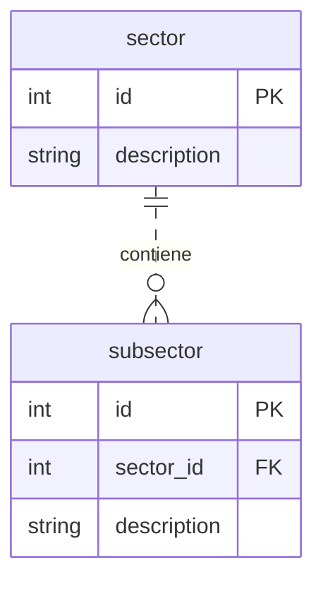
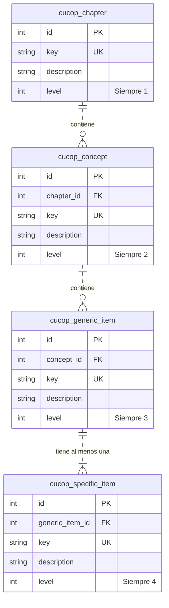

# Esquema de base de datos — Catálogos

**Estado: estructura Mermaid aprobada por el usuario el 2026-10-19.** Los nombres, campos
y relaciones de los diagramas constituyen la base del diseño. Los anchos SQL, longitudes
y verificaciones de datos señalados abajo se concretarán antes de implementar; no se declara
que las tablas hayan sido inspeccionadas ni que se hayan ejecutado migraciones.
Fuente funcional: [catálogos](../domain/catalogs.md), RF-REG-05 y RF-REG-08.
Los catálogos comparten base de datos con el expediente conforme a
[ADR-0001](../adr/0001-backend-arquitectura-hexagonal.md).

Los identificadores Mermaid usan camelCase; los alias indican los nombres de tabla del diseño aprobado.
Los tipos SQL están fijados en [Tipos SQL](#tipos-sql) (decisión del usuario del 2026-10-21).
Los IDs existentes y las claves se conservan; no se generan de nuevo al cargar los datos.

## País, régimen y titularidad jurídica

- `legal_ownership.iso_country` referencia `country.code`; `regime` referencia
  `tax_regime.description`. Se conserva la comparación por código y texto del algoritmo confirmado
  (decisión del 2026-10-21): los datos de Titularidad usan exactamente los códigos de País y los
  textos de Régimen, incluidos acentos. Las filas MX tienen régimen; las extranjeras y `NOT_DEF`, no.
- Nacional: filtrar país y régimen. Extranjero: filtrar país **o** `key = NOT_DEF`, sin régimen.
  Orden ascendente por `key`; `key` es única en la tabla de titularidad.
- La nulabilidad propuesta permite representar opciones generales sin inventar un país o régimen.
  `NOT_DEF` es la fila ID 99 con `iso_country` y `regime` nulos (confirmado el 2026-10-21);
  no se asigna un ID nuevo.
- `tax_regime` representa los IDs del catálogo existente; los códigos técnicos del dominio
  siguen siendo `LEGAL_ENTITY` e `INDIVIDUAL`.
- `getTaxRegimes` proyecta `tax_regime.id` como `id` y `description` como `description`
  (decisión del 2026-10-23). La identidad del solicitante trae `taxRegimeId` con el mismo ID.
- `getCountries` proyecta `country.id` como `id`, `country.name` (nombre en castellano) como
  `description` y `country.code` como `countryCode` (decisión del 2026-10-22). `international_name`
  se conserva en la tabla y no se expone.

## Sector y subsector

Cada subsector tiene un sector obligatorio. Se propone un índice sobre `subsector.sector_id`
para la consulta dependiente. No se añade una relación con Estratificación.

## Catálogos sin relaciones de selección entre sí

```mermaid
erDiagram
    origin["origin"] {
        int id PK "1 nacional; 2 extranjero"
        string description
    }
    businessActivity["business_activity"] {
        int id PK
        string description "Giro"
    }
    stratification["stratification"] {
        int id PK
        string description
        boolean active "Campo Activo existente; no filtra por regimen"
    }
    primaryActivity["primary_activity"] {
        int id PK
        string description "Actividad preponderante"
    }
    workerCountRange["worker_count_range"] {
        int id PK
        string description "Rango de trabajadores"
    }
    annualSalesRange["annual_sales_range"] {
        int id PK
        string description "Rango de ventas anuales"
    }
    supplierStatus["supplier_status"] {
        int id PK
        string description "Estatus del proveedor"
    }
    supplierType["supplier_type"] {
        int id PK
        string description "Tipo de proveedor"
    }
```

Estratificación exige una única selección y no tiene FK ni asociación a régimen.
`active` es la vigencia del registro: la consulta de catálogos solo devuelve registros activos
y el guardado rechaza un ID inactivo con VALIDATION_ERROR. Hoy solo Estratificación tiene este
campo; no se añade a los demás catálogos por suposición.
`supplier_status` y `supplier_type` son catálogos distintos (confirmado el 2026-10-21): Tipo de
proveedor tiene sus propios valores de actividad, sin relación con Estatus. Ninguno representa
`RegistrationStatus` (`IN_PROGRESS` / `REGISTERED`). No se agrega su captura al formulario.
Los tipos de participación CUCoP siguen siendo códigos fijos, no este catálogo de proveedor.

## Jerarquía CUCoP

Cada hijo tiene un padre obligatorio del nivel inmediato anterior. Todo capítulo, concepto y
genérica debe tener al menos una específica entre sus descendientes (decisión del 2026-10-22): una
FK por sí sola no garantiza esa regla; se verifica con pruebas sobre los datos cargados. Se proponen índices sobre las tres FK y checks para `level`.
`key` es única dentro de cada tabla de nivel (constraint UK); entre niveles distintos puede repetirse.
Los IDs pueden coincidir entre niveles; la selección del expediente referencia exclusivamente
`cucop_specific_item.id`, nunca un ID sin identificar el nivel.

## Tipos SQL

Tipos de PostgreSQL 17, en todos los entornos ([ADR-0017](../adr/0017-backend-postgresql-persistencia-duradera.md), [ADR-0018](../adr/0018-backend-postgresql-en-pruebas-y-desarrollo.md)). `INTEGER`, `VARCHAR(n)` y `BOOLEAN` equivalen a `integer`, `varchar(n)` y `boolean`.

| Columna | Tipo SQL |
| :--- | :--- |
| `id` y FK a IDs de catálogo (incluidos IDs de padre CUCoP) | `INTEGER` |
| `level` CUCoP | `INTEGER` |
| Claves: `key`, `country.code` y `legal_ownership.iso_country` | `VARCHAR(50)` |
| Textos descriptivos: `description`, `country.name`, `country.international_name` | `VARCHAR(500)` |
| `legal_ownership.regime` (texto de `tax_regime.description`) | `VARCHAR(500)` |
| `active`, donde exista | `BOOLEAN` |

`VARCHAR(500)` corresponde al VARCHAR2(500) de la fuente. Las columnas que hoy admiten null
(`iso_country` y `regime` en Titularidad Jurídica) se mantienen opcionales; las demás son `NOT NULL`.

## Precisiones físicas antes de implementar

1. Conservar nombres y relaciones aprobados. Tipos SQL fijados el 2026-10-21.
2. Mapeo país/régimen de Titularidad Jurídica resuelto el 2026-10-21: por código de país y texto
   de régimen. `NOT_DEF` es el ID 99, sin país ni régimen.
3. Estatus y Tipo de proveedor son dos catálogos distintos (resuelto el 2026-10-21).
4. Vigencia resuelta el 2026-10-21 (`active` donde exista; hoy solo Estratificación). Las claves
   son únicas dentro de su tabla (UK en `key` y `country.code`), confirmado el 2026-10-21.
5. Las FK desde el expediente y sus secciones se proponen en el
   [diseño de persistencia del registro](registration-database-design.md), aprobado el
   2026-10-20; la aprobación de este documento corresponde a los catálogos.
