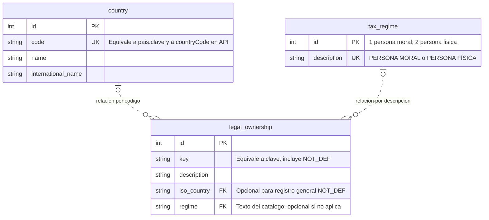
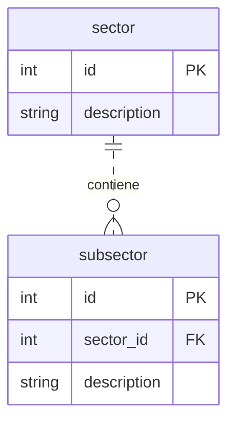
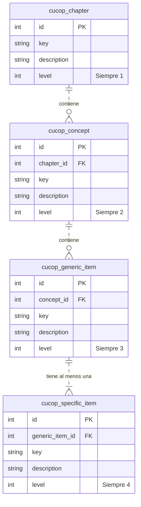

# Esquema de base de datos — Catálogos

**Estado: estructura Mermaid aprobada por el usuario el 2026-10-19.** Los nombres, campos
y relaciones de los diagramas constituyen la base del diseño. Los anchos SQL, longitudes
y verificaciones de datos señalados abajo se concretarán antes de implementar; no se declara
que las tablas hayan sido inspeccionadas ni que se hayan ejecutado migraciones.
Fuente funcional: [catálogos](../domain/catalogs.md), RF-REG-05 y RF-REG-08.
Los catálogos comparten base de datos con el expediente conforme a
[ADR-0001](../adr/0001-backend-arquitectura-hexagonal.md).

Los identificadores Mermaid usan camelCase; los alias indican los nombres de tabla del diseño aprobado.
`int`, `string` y `boolean` son tipos preliminares: el ancho SQL y las longitudes quedan por ajustar.
Los IDs existentes y las claves se conservan; no se generan de nuevo al cargar los datos.

## País, régimen y titularidad jurídica

- `legal_ownership.iso_country` referencia `country.code`; `regime` referencia
  `tax_regime.description`. Se conserva la comparación por código y texto del algoritmo confirmado.
  Si se prefiere normalizar a IDs, deberá ajustarse este diseño y su mapeo, conservando el comportamiento.
- Nacional: filtrar país y régimen. Extranjero: filtrar país **o** `key = NOT_DEF`, sin régimen.
  Orden ascendente por `key`; no se presupone una clave única global de titularidad.
- La nulabilidad propuesta permite representar opciones generales sin inventar un país o régimen.
  Revisar los datos reales de `NOT_DEF` antes de cerrar constraints; no se asigna un ID nuevo.
- `tax_regime` representa los IDs del catálogo existente; los códigos técnicos del dominio
  siguen siendo `LEGAL_ENTITY` e `INDIVIDUAL`.

## Sector y subsector

Cada subsector tiene un sector obligatorio. Se propone un índice sobre `subsector.sector_id`
para la consulta dependiente. No se añade una relación con Estratificación.

## Catálogos sin relaciones de selección entre sí

```mermaid
erDiagram
    origin["origin"] {
        int id PK "1 nacional; 2 extranjero"
        string description
    }
    businessActivity["business_activity"] {
        int id PK
        string description "Giro"
    }
    stratification["stratification"] {
        int id PK
        string description
        boolean active "Campo Activo existente; no filtra por regimen"
    }
    primaryActivity["primary_activity"] {
        int id PK
        string description "Actividad preponderante"
    }
    workerCountRange["worker_count_range"] {
        int id PK
        string description "Rango de trabajadores"
    }
    annualSalesRange["annual_sales_range"] {
        int id PK
        string description "Rango de ventas anuales"
    }
    supplierStatus["supplier_status"] {
        int id PK
        string description "Estatus del proveedor"
    }
    supplierType["supplier_type"] {
        int id PK
        string description "Tipo de proveedor"
    }
```

Estratificación exige una única selección y no tiene FK ni asociación a régimen.
Se muestra `active` porque existe en la documentación actual; revisar su uso efectivo,
sin añadir filtros de vigencia a los demás catálogos por suposición.
`status` y `type` del proveedor aparecen separados en la fuente aunque sus valores coinciden:
queda por revisar si realmente son dos catálogos o uno duplicado. Ninguno representa
`RegistrationStatus` (`IN_PROGRESS` / `REGISTERED`). No se agrega su captura al formulario.
Los tipos de participación CUCoP siguen siendo códigos fijos, no este catálogo de proveedor.

## Jerarquía CUCoP

Cada hijo tiene un padre obligatorio del nivel inmediato anterior. Toda genérica debe tener
al menos una específica: una FK por sí sola no garantiza esa regla; se verificará al preparar
los datos y consultar el catálogo. Se proponen índices sobre las tres FK y checks para `level`.
No se declara unicidad de `key` sin revisar si la clave es única globalmente o dentro de su padre.
Los IDs pueden coincidir entre niveles; la selección del expediente referencia exclusivamente
`cucop_specific_item.id`, nunca un ID sin identificar el nivel.

## Precisiones físicas antes de implementar

1. Conservar nombres y relaciones aprobados; fijar tipos SQL concretos y longitudes.
2. Confirmar el mapeo de país/régimen en Titularidad Jurídica y los valores de `NOT_DEF`.
3. Revisar si Estatus y Tipo de proveedor son dos catálogos distintos.
4. Confirmar campos de vigencia existentes y restricciones de unicidad de claves.
5. Incorporar después las FK desde los datos del expediente hacia estos catálogos;
   el presente borrador cubre los catálogos, no el esquema completo del registro.
