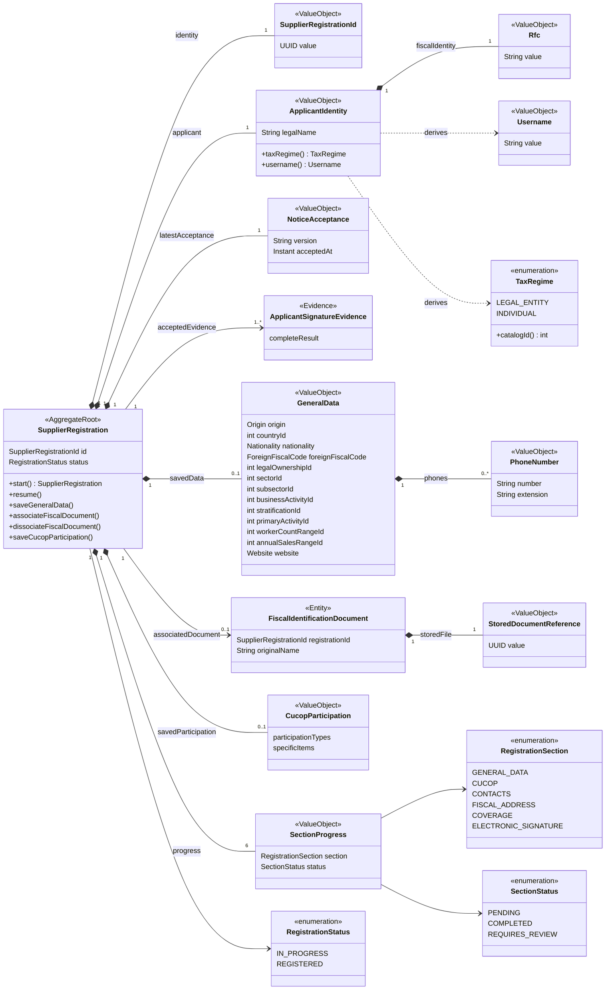
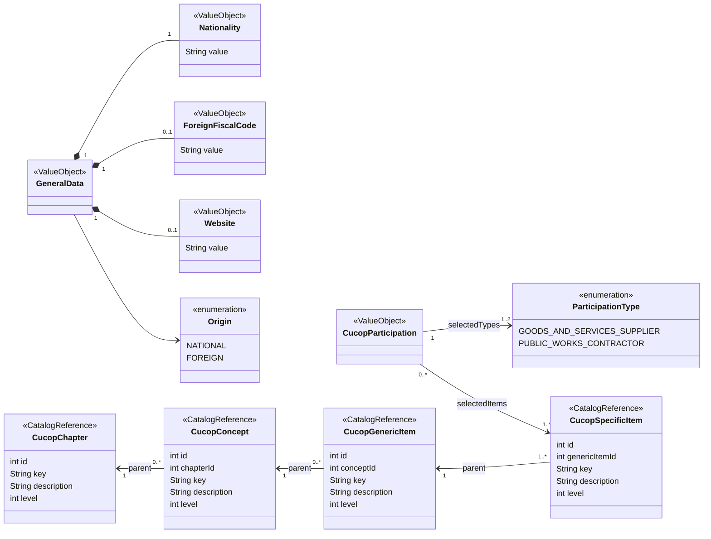

# Modelo de dominio — Registro de proveedores de Fredkor Labs

Define entidades, valores, relaciones y reglas de la primera etapa; las decisiones técnicas
se consultan en los ADR y la coordinación en arquitectura. Se conservan INV-01 a INV-39
para mantener trazabilidad, incluidas reglas de proceso garantizadas fuera del dominio.

## 1. Glosario de negocio

| Término | Definición |
| :--- | :--- |
| Solicitante | Persona física o moral que inicia o continúa su registro como proveedor. |
| Expediente | Información del proceso de registro, identificada por UUID y asociada a un RFC. |
| RFC | Identidad fiscal obtenida de la Firma Electrónica del solicitante, obligatoria e inmutable durante la captura. |
| Régimen | Persona moral o física, calculada según la longitud del RFC. |
| Usuario | RFC en minúsculas, mostrado en un campo de solo lectura. |
| Origen | Nacional o Extranjero, seleccionado por el proveedor. |
| Código fiscal extranjero | Texto requerido para origen Extranjero, separado del RFC. |
| Aceptación de políticas | Evidencia de versión y fecha/hora de aceptación de la Política de Aviso. |
| Resultado de la Firma Electrónica del solicitante | Datos de firma entregados por el componente externo y aceptados por Fredkor Labs. |
| Sección | Parte del asistente cuyo avance se valida y guarda mediante Siguiente. |
| Cédula fiscal | Único PDF obligatorio de identificación fiscal, asociado al completar su carga. |
| Tipo de participación | Proveedor de adquisiciones, arrendamientos y servicios, contratista de obra pública o servicios relacionados, o ambos. |
| Partida específica | Nivel seleccionable final del árbol CUCoP. |
| Clave del proveedor | SupplierCode asignado al finalizar, en una etapa posterior. |

## 2. Diagramas de clases

Los diagramas representan el modelo conceptual de dominio, como en el proyecto de referencia.
Los atributos derivados se identifican con métodos; las operaciones son conceptuales, no firmas
Java definitivas. No incluyen controladores, entidades JPA, contexto JWT ni procesos de archivos.

### 2.1. Expediente, identidad y secciones

- `sectorId`, `subsectorId`, `foreignFiscalCode` y `website` son condicionales u opcionales
  conforme a RF-REG-05. Los atributos terminados en `Id` representan referencias conceptuales
  a catálogos, no un esquema JPA ni una elección de tipos primitivos para código definitivo.
- La colección de teléfonos tiene al menos un elemento para persona moral al completar
  Datos Generales; persona física no captura teléfonos.
- El documento puede estar asociado antes de guardar Datos Generales. Eliminar lo desasocia
  y devuelve la sección a PENDING; la limpieza física no es una operación del agregado.
- Cada una de las seis secciones tiene un progreso; REQUIRES_REVIEW permanece reservado
  para reglas futuras y no se asigna a CUCoP por cambios en Datos Generales.
- La aceptación es únicamente la última confirmada; las evidencias de firma conservan historial.
  `completeResult` representa el valor íntegro, sin prescribir un tipo JSON en dominio.

### 2.2. Valores de captura y referencias CUCoP

La jerarquía CUCoP pertenece a los catálogos, no al ciclo de vida del expediente. Los niveles
son 1 a 4, respectivamente. Se guardan referencias a específicas, sin persistir selecciones
independientes de genéricas, conceptos o capítulos. Los nombres de padre del diagrama son
conceptuales; el [esquema de catálogos](catalog-database-proposal.md) define el mapeo físico.

La finalización (`complete`, `SupplierCode` y fecha de cierre) permanece fuera de estos
diagramas de primera etapa y se conserva documentada como operación futura.

## 3. Invariantes y responsabilidades

En este documento, INV identifica reglas de negocio y condiciones del proceso. Algunas
se garantizan en el dominio; otras requieren aplicación, integración, interfaz o persistencia.
Una restricción de interfaz no sustituye la validación aplicable al guardado.

Las referencias US01 a US11 corresponden al prefijo de los archivos de historias; sus
encabezados actuales conservan HU-REG-001 a HU-REG-011. Los números CA corresponden a
los criterios de aceptación de cada archivo. Cuando un detalle está definido en una tabla
de campos sin CA individual, se indica expresamente.

### Identificación y políticas

| ID | Regla | Dónde se garantiza | Fuente | Criterios o detalle funcional |
| :--- | :--- | :--- | :--- | :--- |
| INV-01 | El RFC obtenido de la Firma Electrónica del solicitante es obligatorio y solo admite 12 o 13 caracteres. No se define un patrón adicional. | Dominio: valor RFC; aplicación: aceptar resultado de la Firma Electrónica del solicitante. | RF-REG-01, RF-REG-05 | US01 CA-010, CA-011; US08 CA-016 |
| INV-02 | La identidad requiere nombre extraído del certificado verificado; la evidencia conserva el nombre recibido. Extracción conforme a ADR-0016. | Aplicación: aceptar resultado de la Firma Electrónica del solicitante. | RF-REG-01 | US01 CA-002, CA-010, CA-023 a CA-025 |
| INV-03 | El componente de Firma Electrónica del solicitante solo procesa certificados vigentes y validados contra OCSP. Error, cancelación o ausencia de resultado impiden continuar y crear expediente. | Componente externo de Firma Electrónica del solicitante: vigencia y OCSP; integración y aplicación: procesar resultado o error. | RF-REG-01 | US01 CA-003, CA-004, CA-005, CA-007, CA-008, CA-009 |
| INV-04 | La identificación exige sello verificado y correspondencia del RFC con el titular del mismo certificado según ADR-0016; un fallo impide aceptarla. | Integración criptográfica del backend, coordinada por aplicación. | RF-REG-01 | US01 CA-014, CA-015, CA-020 a CA-022 |
| INV-05 | La firma inicial utiliza la cadena literal `Temporal` y no finaliza el registro. | Integración de Firma Electrónica del solicitante y flujo de aplicación. | RF-REG-01 | US01 CA-012 |
| INV-06 | Se conserva íntegramente el resultado exitoso aceptado de la Firma Electrónica del solicitante. No se almacena la llave privada `.key` ni su contraseña. | Aplicación y adaptadores de persistencia e integración. | RF-REG-01 | US01 CA-006, CA-013 |
| INV-07 | La Política de Aviso debe aceptarse expresamente antes de solicitar la firma. Cancelar o fallar al registrar la aceptación impide firmar e iniciar expediente. | Interfaz: presentación; aplicación: condición previa de firma y creación. | RF-REG-03 | US03 CA-001, CA-002, CA-003, CA-004 |
| INV-08 | El aviso es fijo, versión 1.0. El expediente conserva solo la última aceptación confirmada, con versión y fecha/hora; al reanudar se sustituye transaccionalmente sin historial de aceptaciones y sin alterar las evidencias de firma históricas. | Aplicación y persistencia de la aceptación. | RF-REG-03 | US03 CA-003, CA-005, CA-007, CA-008 |

### Expediente y acceso

| ID | Regla | Dónde se garantiza | Fuente | Criterios o detalle funcional |
| :--- | :--- | :--- | :--- | :--- |
| INV-09 | Existe como máximo un expediente para el mismo RFC, incluso ante concurrencia. Un error de consulta no equivale a inexistencia. | Aplicación: consulta y decisión; persistencia: garantía de unicidad. | RF-REG-02, RF-REG-04 | US02 CA-001, CA-002, CA-003, CA-004; US04 CA-003 |
| INV-10 | Crear expediente requiere políticas aceptadas, identificación exitosa e inexistencia comprobada. Se genera UUID único, estado EN_CAPTURA y asociación al RFC e identidad. | Dominio: estado e identidad; aplicación: precondiciones y creación; persistencia: guardado. | RF-REG-04 | US04 CA-001, CA-004, CA-005, CA-006 |
| INV-11 | El RFC del expediente es inmutable; el RFC y la razón social no se modifican mediante la captura. Solo al reanudar se actualiza la razón social desde el nuevo certificado verificado del mismo RFC, conforme a US05 CA-009 a CA-011. | Dominio: identidad; interfaz: solo lectura; aplicación: respetar identidad verificada. | RF-REG-02, RF-REG-05 | US02 CA-005; US08 CA-002 |
| INV-12 | Reanudar exige una nueva identificación y solo permite el expediente del mismo RFC. No crea otro expediente; un error no sobrescribe datos persistidos. | Aplicación: identidad y recuperación; persistencia. | RF-REG-06 | US05 CA-001, CA-004, CA-005, CA-008 |
| INV-13 | Un expediente REGISTRADO no permite nueva alta ni reanudación como borrador en este flujo. | Dominio: condición de estado; aplicación: decidir flujo. | RF-REG-02, RF-REG-06 | US02 CA-003; US05 CA-006 |

### Datos Generales

| ID | Regla | Dónde se garantiza | Fuente | Criterios o detalle funcional |
| :--- | :--- | :--- | :--- | :--- |
| INV-14 | El régimen se calcula con la longitud del RFC: 12 para PERSONA MORAL y 13 para PERSONA FÍSICA. Es de solo lectura. Se persiste en `supplier_registration.tax_regime_id` para reportes, con un check que lo ata a la longitud del RFC. | Dominio: cálculo; interfaz: solo lectura; persistencia: copia para reportes. | RF-REG-05 | US08 CA-011, CA-012 |
| INV-15 | Usuario es el RFC convertido a minúsculas, de solo lectura, y se muestra desde la primera identificación exitosa. | Dominio: valor derivado; aplicación e interfaz: presentación. | RF-REG-05 | US08 CA-019 |
| INV-16 | Origen es obligatorio y lo selecciona el proveedor entre Nacional y Extranjero. | Dominio: catálogo fijo y obligatoriedad; interfaz: selección. | RF-REG-05 | US08 CA-017 |
| INV-17 | País es obligatorio. Para Nacional debe ser México y de solo lectura; para Extranjero se selecciona del catálogo. | Dominio: coherencia de país y origen; aplicación: catálogo; interfaz. | RF-REG-05 | US08 CA-009, CA-010 |
| INV-18 | Nacionalidad es obligatoria: Mexicana y de solo lectura para Nacional (el guardado exige exactamente `Mexicana`); captura alfanumérica de hasta 250 caracteres para Extranjero. | Dominio: validación condicional; interfaz: captura y solo lectura. | RF-REG-05 | US08: tabla de campos; CA-005, CA-006 |
| INV-19 | Código fiscal extranjero es un texto separado del RFC, editable, visible y obligatorio solo para Extranjero, con máximo 20 caracteres. | Dominio: obligatoriedad y longitud; interfaz: visibilidad. | RF-REG-05 | US08 CA-015, CA-018 |
| INV-20 | Titularidad jurídica es obligatoria: para Nacional sus opciones coinciden con país y régimen; para Extranjero coinciden con país o clave NOT_DEF, sin filtro por régimen, incluso cuando existen opciones del país. Orden por clave y respaldo NOT_DEF según domain/catalogs.md. | Aplicación: consultar catálogo y relaciones; dominio: selección coherente. | RF-REG-05 | US08 CA-003, CA-014 |
| INV-21 | Sector y Subsector son obligatorios solo para persona moral; el subsector corresponde al sector elegido. No se solicitan a persona física. | Dominio: condición y coherencia; aplicación: relaciones de catálogo; interfaz. | RF-REG-05 | US08: tabla de campos; CA-004, CA-006 |
| INV-22 | Giro, Estratificación, Actividad preponderante, Número de trabajadores y Ventas anuales son obligatorios y seleccionados de catálogo; Estratificación requiere exactamente una opción, sin asociación ni filtro por régimen. | Dominio: obligatoriedad; aplicación: registros de catálogo. | RF-REG-05 | US08: tabla de campos; CA-005, CA-006, CA-022 |
| INV-23 | Las selecciones de catálogos dinámicos se validan contra registros vigentes cuando aplique. | Aplicación mediante acceso a catálogos; dominio consume los datos necesarios para validar. | RF-REG-05 | US08 CA-008 |
| INV-24 | Página web es opcional; si se informa debe ser URL absoluta con esquema http o https y host válido, de hasta 2048 caracteres tras recortar extremos; vacío se convierte a null. No se agrega protocolo ni se consulta la red para validar. | Dominio: formato y longitud. | RF-REG-05 | US08 CA-013 |
| INV-25 | Cambiar el campo de dependencia descarta sus selecciones dependientes y exige elegirlas nuevamente. Los valores predeterminados de solo lectura siguen sus reglas propias. | Interfaz: limpiar selecciones; dominio y aplicación: validar coherencia al guardar. | RF-REG-05 | US08 CA-020 |

### Teléfonos y cédula fiscal

| ID | Regla | Dónde se garantiza | Fuente | Criterios o detalle funcional |
| :--- | :--- | :--- | :--- | :--- |
| INV-26 | Solo persona moral captura teléfonos y requiere al menos uno para avanzar. Cada fila debe tener número de 10 dígitos; extensión opcional de hasta 5 caracteres. Filas incompletas o inválidas impiden avanzar. | Dominio: colección y valores telefónicos; aplicación: validar guardado. | RF-REG-05 | US09 CA-001, CA-003, CA-004, CA-005 |
| INV-27 | La cédula fiscal es obligatoria para Nacional y Extranjero al completar Datos Generales; se admite un solo PDF de máximo 5 MiB (5,242,880 bytes). | Dominio: obligatoriedad, cantidad, formato y tamaño (`FiscalDocumentFormat`); aplicación: validar antes de conservar; adaptador de archivos: guardar el contenido. | RF-REG-05 | US10 CA-002, CA-003, CA-004 |
| INV-28 | La carga exitosa conserva y asocia inmediatamente el archivo, incluso sin Siguiente; volver o reanudar lo recupera. Cargar no completa Datos Generales. | Dominio: asociación sin completar Datos Generales (`SupplierRegistration.associateFiscalDocument`); aplicación, almacenamiento y persistencia de la carga. | RF-REG-05 | US10 CA-005 a CA-007, CA-010 |
| INV-29 | Eliminar exige confirmación; desasociación, marca de metadatos y progreso se confirman en una transacción de BD, sin borrar contenido físico. Fallo conserva estado previo; éxito deja Datos Generales PENDING y CUCoP intacto. | Dominio: desasociación y Datos Generales PENDING (`SupplierRegistration.dissociateFiscalDocument`); interfaz, aplicación y persistencia; limpieza física por ADR-0010. | RF-REG-05 | US10 CA-006, CA-007, CA-011 |

### CUCoP

| ID | Regla | Dónde se garantiza | Fuente | Criterios o detalle funcional |
| :--- | :--- | :--- | :--- | :--- |
| INV-30 | Acceder a CUCoP requiere Datos Generales guardados correctamente: la sección GENERAL_DATA en COMPLETED. Con PENDING, aunque existan datos guardados (p. ej., tras eliminar la cédula), guardar CUCoP se rechaza con INVALID_STATE_TRANSITION (decisión del 2026-10-23). | Dominio: precondición de la sección (`SupplierRegistration.saveCucopParticipation`). | RF-REG-08 | US11 CA-001 |
| INV-31 | Completar CUCoP exige al menos un tipo de participación y una partida específica. Se permite seleccionar ambos tipos de participación y múltiples específicas. Un tipo o una específica repetidos en la petición se rechazan con VALIDATION_ERROR, sin deduplicar (decisión del 2026-10-23). | Dominio: validación de la sección. | RF-REG-08 | US11 CA-003, CA-004, CA-005, CA-011 |
| INV-32 | La jerarquía es Capítulo → Concepto → Partida genérica → Partida específica; cada hijo referencia el ID de su padre inmediato y todo capítulo, concepto y genérica tiene al menos una específica. | Catálogos y su persistencia; aplicación: consulta jerárquica. | RF-REG-08; domain/catalogs.md | US11: Campos y condiciones; CA-005 |
| INV-33 | Solo genéricas y específicas tienen selección editable. Seleccionar una genérica selecciona todas sus específicas; deseleccionarla deselecciona todas ellas. Deshacer selección limpia todo el árbol y la tabla. | Interfaz: operaciones de selección; aplicación: recibir la selección para validación y guardado. | RF-REG-08 | US11 CA-007, CA-008, CA-013, CA-014 |

### Guardado y avance

| ID | Regla | Dónde se garantiza | Fuente | Criterios o detalle funcional |
| :--- | :--- | :--- | :--- | :--- |
| INV-34 | Siguiente valida y guarda transaccionalmente antes de avanzar. Solo un guardado exitoso marca la sección COMPLETADA; un error no permite avanzar ni declararla completa. | Dominio: reglas de sección; aplicación: transacción y avance; persistencia. | RF-REG-05, RF-REG-08 | US06 CA-002, CA-003, CA-004; US08 CA-006, CA-007; US11 CA-011, CA-012 |
| INV-35 | Atrás descarta los cambios sin guardar de la sección abandonada; al regresar se muestran solo valores persistidos o la captura inicial si no existen. No revierte cargas o eliminaciones exitosas de archivos; muestra las asociaciones actuales al regresar. | Interfaz y aplicación: separación de navegación y guardado. | RF-REG-05, RF-REG-08 | US06 CA-009; US11 CA-010 |
| INV-36 | Iniciar o reanudar abre Datos Generales. Reanudar recupera datos y progreso sin exigir recaptura. Los títulos de sección no permiten navegación directa. | Aplicación e interfaz: recuperación y navegación. | RF-REG-04, RF-REG-05, RF-REG-06 | US04 CA-002; US05 CA-002, CA-003, CA-007; US06 CA-007; US08 CA-001 |
| INV-37 | Los cambios en Datos Generales afectan únicamente a esa sección. CUCoP conserva sus tipos de participación, partidas seleccionadas y estado de progreso, incluso al eliminar la cédula fiscal; no se borra, invalida ni marca para revisión por esos cambios. | Dominio y aplicación: consistencia entre secciones. | RF-REG-05 | US06 CA-006, CA-008 |

### Finalización — etapa posterior

| ID | Regla | Dónde se garantiza | Fuente | Criterios o detalle funcional |
| :--- | :--- | :--- | :--- | :--- |
| INV-38 | Finalizar exige secciones obligatorias completas, válidas y consistentes; cualquier pendiente impide el cierre. | Dominio y aplicación; pendiente de reglas de las secciones futuras. | RF-REG-07 | US07 CA-001, CA-002 |
| INV-39 | La finalización asigna SupplierCode, cambia a REGISTRADO y registra fecha/hora de forma atómica, sin resultados parciales ni duplicados ante reintentos. | Dominio: transición; aplicación: finalización; persistencia: atomicidad y unicidad. | RF-REG-07 | US07 CA-003, CA-004, CA-005, CA-006 |

## 4. Agregado y límites de consistencia

`SupplierRegistration` es la raíz, identificada por `SupplierRegistrationId` (UUID) y
por RFC como clave de negocio única. La unicidad entre expedientes pertenece a persistencia.
El agregado contiene identidad, última aceptación del aviso, referencias históricas de firma,
Datos Generales, cédula asociada, CUCoP y progreso por sección.

`GeneralData` y `CucopParticipation` están ausentes antes de su primer guardado válido.
Los formularios incompletos, filas vacías, filtros y expansión del árbol pertenecen a la interfaz.
El progreso persistido no representa la sección visible ni la validez momentánea del formulario.

`FiscalIdentificationDocument` representa la referencia del único documento asociado al
expediente; el agregado conoce su disponibilidad, no bytes ni rutas.
La gestión general del archivo pertenece a [ADR-0010](../adr/0010-backend-almacenamiento-documental-en-volumen.md).
Eliminar la cédula exitosamente retira su asociación y deja Datos Generales PENDING.
Una nueva carga conserva el documento, pero completar la sección requiere Siguiente; CUCoP no cambia.
`FiscalDocumentFormat` valida la cédula antes de conservarla: primero el tamaño (máximo 5,242,880 bytes;
si lo excede, 413) y después la extensión `.pdf` sin distinguir mayúsculas y que el contenido empiece
con `%PDF-` (si falla, 415). El MIME declarado no basta (INV-27, ADR-0010).

`ApplicantSignatureEvidence` conserva íntegro cada resultado aceptado, sin llave privada ni
contraseña. El expediente referencia la evidencia inicial y las vinculadas al reanudar,
sin sobrescritura. No es un DTO del componente ni necesita una biblioteca JSON en dominio;
el adaptador preserva el resultado original según el contrato y ADR-0016. El mapeo de campos
se conserva en [integración de firma](../api/signature-integration.md).

## 5. Objetos de valor y datos de las secciones

### 5.1. Identidad y aceptación

| Tipo | Contenido y comportamiento | Reglas |
| :--- | :--- | :--- |
| `SupplierRegistrationId` | UUID del expediente. No representa el RFC ni la clave final del proveedor. | INV-10 |
| `Rfc` | Texto obligatorio de 12 o 13 caracteres. Conserva el RFC recibido; no se añade un patrón ni normalización adicional. | INV-01, INV-11 |
| `ApplicantIdentity` | `Rfc` contrastado con el certificado y `legalName` extraído del sujeto del mismo certificado según ADR-0016; la evidencia conserva los campos originales de PKI. Expone régimen y usuario como valores derivados, sin modificadores de captura. | INV-01, INV-02, INV-11, INV-14, INV-15 |
| `TaxRegime` | Catálogo fijo. Se deriva de la longitud del RFC: 12 → LEGAL_ENTITY; 13 → INDIVIDUAL. | INV-14 |
| `Username` | Valor derivado del RFC en minúsculas. No se recibe como dato editable independiente. | INV-15 |
| `NoticeAcceptance` | Versión del aviso y fecha/hora (`Instant`) de aceptación. No contiene un rechazo como aceptación válida. | INV-07, INV-08 |
| `CertificateSubjectAttribute` | Un atributo del sujeto del certificado: OID y valor, en el orden en que aparece en el certificado. Lo entrega el adaptador de firma. | ADR-0016 |
| `CertificateIdentity` | Identidad leída del sujeto; puente entre el certificado y `ApplicantIdentity`. RFC titular: primer segmento, separado por `/`, del atributo `2.5.4.45`, sin recortes ni cambios de mayúsculas, de 12 o 13 caracteres; los segmentos siguientes (p. ej. el RFC del representante) nunca son alternativas. Nombre: el primer atributo, en el orden del certificado, con OID `2.5.4.3`, `2.5.4.41` o `2.5.4.10`, no vacío. `matching(rfc)` exige que el RFC recibido coincida con el titular y produce `ApplicantIdentity`. | INV-04; ADR-0016 |

El origen no se deduce del RFC ni del certificado: el proveedor lo selecciona. El régimen
no es un campo editable ni se deduce del país. No se introducen límites de nombre completo
/ razón social que no estén definidos en los RF.

### 5.2. Datos Generales: `GeneralData`

Es un objeto de valor que representa la información válida que se guarda al completar
Datos Generales. Se reemplaza como unidad validada al guardar correctamente, conservando
la identidad de solo lectura en el expediente. 

| Miembro | Tipo conceptual | Regla de construcción o validación |
| :--- | :--- | :--- |
| `origin` | `Origin` | Obligatorio, NATIONAL o FOREIGN. |
| `country` | Referencia a país | Obligatorio; México para NATIONAL, seleccionable para FOREIGN. |
| `nationality` | `Nationality` | Obligatoria; Mexicana para NATIONAL o texto alfanumérico de hasta 250 caracteres para FOREIGN. |
| `foreignFiscalCode` | `ForeignFiscalCode` | Máximo 20 caracteres, obligatorio para FOREIGN y no solicitado para NATIONAL. No se modifica el RFC para representar este dato. |
| `legalOwnership` | Referencia a titularidad jurídica | Obligatoria: Nacional exige país y régimen; Extranjero admite país o clave NOT_DEF, sin filtro por régimen. Ver algoritmo en domain/catalogs.md. |
| `sector` | Referencia a sector | Obligatoria para persona moral; no solicitada para persona física. |
| `subsector` | Referencia a subsector | Obligatoria para persona moral y relacionada con el sector seleccionado. |
| `businessActivity` | Referencia a giro | Obligatoria. |
| `stratification` | Referencia a estratificación | Obligatoria: exactamente una opción del catálogo, sin asociación ni filtro por régimen. |
| `primaryActivity` | Referencia a actividad preponderante | Obligatoria. |
| `workerCountRange` | Referencia a rango de trabajadores | Obligatoria. |
| `annualSalesRange` | Referencia a rango de ventas anuales | Obligatoria. |
| `website` | `Website` opcional | Si se informa, URL absoluta con esquema http o https y host válido, de hasta 2048 caracteres tras recortar extremos; vacío se convierte a null. No se agrega protocolo ni se consulta la red para validar. |
| `phones` | Colección de `PhoneNumber` | Aplicable a persona moral; requiere al menos uno y todos deben ser válidos. |

Las referencias a catálogos dinámicos contienen la identidad del registro. No convierten sus
valores en enums ni duplican el catálogo entero dentro de `GeneralData`. Todos los IDs de catálogo son enteros; los tipos físicos están en el
[esquema de catálogos](catalog-database-proposal.md#tipos-sql).

La aplicación resuelve las referencias y aporta al dominio los valores y relaciones
necesarios para comprobar vigencia cuando aplique y compatibilidad de titularidad o
sector/subsector. Este contexto de validación es información de dominio, no una conexión
al catálogo ni un repositorio dentro del dominio.

Ese contexto es `GeneralDataCatalogContext`: código del país, titularidad seleccionada
(`LegalOwnershipOption`), sector del subsector, existencia del sector, giro, actividad preponderante y
rangos, y vigencia de la estratificación; un ID que no está en su catálogo deja su dato en null o false.
La captura llega como `GeneralDataInput`, ya recortada (ADR-0009) y sin validar: `phones` es null si la
petición envía null y vacía si envía una colección vacía. Solo `GeneralData` representa datos válidos.
Cada regla incumplida es un `GeneralDataViolation` con el campo, con los nombres de la petición
(p. ej. `phones/0/number`), y su motivo; la validación las reúne todas para responder un único
VALIDATION_ERROR con un pointer por campo (ADR-0019).

La validación completa recibe la identidad y la disponibilidad de la cédula del expediente.
Construir `GeneralData` no crea ni carga un documento. La raíz solo admite completar esta
sección cuando datos, teléfonos aplicables y cédula fiscal satisfacen sus reglas.

Los campos opcionales admiten null como ausencia, sin conservar automáticamente el valor
anterior al guardar. Un campo que es obligatorio por las condiciones aplicables no admite
null. Carga y eliminación documentales se confirman en sus propias operaciones.

### 5.3. Teléfonos: `PhoneNumber`

| Miembro | Representación conceptual | Regla |
| :--- | :--- | :--- |
| `number` | Texto de dígitos | Obligatorio, exactamente 10 dígitos. Se representa como texto para conservar los dígitos capturados. |
| `extension` | Texto opcional | Hasta 5 caracteres; no se añade restricción exclusivamente numérica. |

Los teléfonos se modelan como valores dentro de `GeneralData`, sin introducir identificadores
propios, tipos de teléfono, unicidad o límites máximos de cantidad no definidos. Las filas
vacías son un estado del formulario, no objetos `PhoneNumber` válidos guardados.

### 5.4. CUCoP: `CucopParticipation`

| Miembro | Tipo conceptual | Regla |
| :--- | :--- | :--- |
| `participationTypes` | Colección de `ParticipationType` | Al menos un tipo; admite ambos valores del catálogo fijo. |
| `specificItems` | Colección de referencias a `CucopSpecificItem` | Al menos una partida específica del catálogo; admite múltiples selecciones. |

Esta sección guarda la selección funcional de específicas y tipos de participación.
Capítulos, conceptos y genéricas son referencias de navegación del catálogo. No se añade
una selección de negocio independiente para los niveles superiores.

La interfaz expande una selección genérica a sus específicas y aplica deselección y
Deshacer selección. La aplicación resuelve las específicas seleccionadas contra el catálogo;
una casilla de la interfaz no sustituye la referencia al registro del catálogo. El modelo
no exige guardar la estructura visual, filtros de búsqueda, paginación ni estados de expansión.
Del mismo modo que en Datos Generales, `CucopParticipationViolation` registra cada regla incumplida con
su campo (p. ej. `specificItemIds/2`) y su motivo (INV-31).

### 5.5. Catálogos de referencia

| Tipo conceptual | Datos conocidos | Relación |
| :--- | :--- | :--- |
| `CucopChapter` | `id`, `key`, `description`, `level = 1` | Raíz. |
| `CucopConcept` | `id`, `key`, `description`, `level = 2`, referencia al padre | Padre `CucopChapter`. |
| `CucopGenericItem` | `id`, `key`, `description`, `level = 3`, referencia al padre | Padre `CucopConcept`. Tiene específicas. |
| `CucopSpecificItem` | `id`, `key`, `description`, `level = 4`, referencia al padre | Padre `CucopGenericItem`. |
| `LegalOwnershipOption` | `id`, `key`, `description`, `countryCode` y `regime`; los dos últimos son null en opciones generales como `NOT_DEF` | Aplica el algoritmo de [catalogs.md](../domain/catalogs.md) §4 (INV-20): `appliesTo` decide si una opción aplica y `applicable` devuelve las aplicables ordenadas por `key`. |

Estos nombres de dominio se corresponden con `capitulo`, `concepto`, `partida_generica` y
`partida_especifica` de [catalogs.md](../domain/catalogs.md). No renombran las tablas
existentes ni fijan el nombre físico de sus columnas. El expediente referencia los registros;
no es propietario de su ciclo de vida ni los modifica al seleccionar partidas.

Los demás catálogos dinámicos se representan de igual forma como entidades de referencia
externas al agregado del expediente, con los datos ya definidos en `catalogs.md`.

## 6. Relaciones y cardinalidades

| Origen | Relación | Destino | Cardinalidad y condición |
| :--- | :--- | :--- | :--- |
| `SupplierRegistration` | Composición | `ApplicantIdentity` | Una desde la creación. |
| `ApplicantIdentity` | Composición | `Rfc` | Uno; régimen y usuario se derivan de él. |
| `SupplierRegistration` | Composición | `NoticeAcceptance` | Una sola aceptación vigente: la de creación o la última confirmada al reanudar; se sustituye sin historial de aceptaciones. Se mantiene versión fija 1.0 y fecha/hora del backend; un fallo conserva la anterior. |
| `SupplierRegistration` | Referencia | `ApplicantSignatureEvidence` | Evidencia inicial y colección histórica de nuevas evidencias vinculadas al reanudar; se conservan íntegras sin sobrescritura. Su vínculo histórico se confirma con la actualización del nombre en la transacción de reanudación. |
| `SupplierRegistration` | Composición | `GeneralData` | Cero antes del primer guardado; uno tras guardarlo. |
| `GeneralData` | Composición | `PhoneNumber` | Colección; al menos uno para persona moral al completar. |
| `SupplierRegistration` | Asociación documental | `FiscalIdentificationDocument` | Cero o uno durante captura; uno para completar Datos Generales. |
| `SupplierRegistration` | Composición | `CucopParticipation` | Cero antes del primer guardado CUCoP; uno después. |
| `CucopParticipation` | Referencia | `CucopSpecificItem` | Una o más al completar CUCoP. |
| `SupplierRegistration` | Composición | `SectionProgress` | Una condición por sección. |
| Catálogo CUCoP hijo | Referencia al padre | Nivel inmediatamente superior | Cada hijo contiene el ID de su padre. |

Estas relaciones representan el dominio; no prescriben tablas, claves foráneas, anotaciones
JPA, cascadas ni serialización del contrato web.

## 7. Operaciones del agregado

| Operación | Responsabilidad | Reglas |
| :--- | :--- | :--- |
| `SupplierRegistration.start` | Crear con identidad aceptada, aviso y estado IN_PROGRESS. | INV-09 a INV-11 |
| Reanudar | Mantener RFC e ID; actualizar nombre, última aceptación y referencias históricas de evidencia sin alterar datos ni progreso. | INV-06, INV-08, INV-11 a INV-13, INV-36 |
| `SupplierRegistration.associateFiscalDocument` | Asociar de inmediato la cédula ya validada y conservada, con el expediente IN_PROGRESS y sin otra cédula asociada; no completa Datos Generales. | INV-27, INV-28 |
| `SupplierRegistration.dissociateFiscalDocument` | Retirar la cédula asociada con el expediente IN_PROGRESS y dejar Datos Generales PENDING, sin modificar sus datos ni CUCoP. | INV-29, INV-37 |
| `SupplierRegistration.saveGeneralData` | Validar datos, teléfonos, catálogos y cédula; sustituir la sección como unidad válida. | INV-16 a INV-29, INV-34, INV-37 |
| `SupplierRegistration.saveCucopParticipation` | Exigir Datos Generales guardados y participación válida; conservar específicas seleccionadas. | INV-30 a INV-34 |
| `SupplierRegistration.complete` | Finalizar cuando se definan todas las reglas de la etapa posterior. | INV-38, INV-39 |

La raíz no carga ni elimina contenido físico, verifica firmas ni consulta repositorios.
La aplicación coordina esas capacidades según [arquitectura](architecture.md).

## 8. Reconstitución y validación

- Reconstituir recupera el estado guardado sin ejecutar alta ni transiciones; no autoriza acceso.
- Validar una actualización antes de sustituir valores. Los textos editables se normalizan
  según [ADR-0009](../adr/0009-shared-null-explicito-en-requests.md); identidad y evidencia permanecen intactas.
- Recibir instantes desde aplicación; los objetos no consultan la hora del sistema.
- Probar reglas puras sin Spring; las garantías de persistencia e integración se verifican
  en sus fronteras conforme a [trazabilidad](../traceability.md).

## 9. Límites y fuentes

- Estados y secciones: [ciclo de vida](../domain/supplier-registration-lifecycle.md).
- Códigos y relaciones de referencia: [catálogos](../domain/catalogs.md).
- Reglas funcionales: [RF-REG-01 a RF-REG-08](../requirements/functional.md).
- Criterios verificables y correspondencia INV/US: [trazabilidad](../traceability.md).
- El esquema físico de catálogos está [aprobado en estructura](catalog-database-proposal.md).
- La finalización y las secciones posteriores requieren especificaciones antes de habilitarse.
  No se agregan normalización del RFC, caducidad ni estados nuevos por inferencia.
