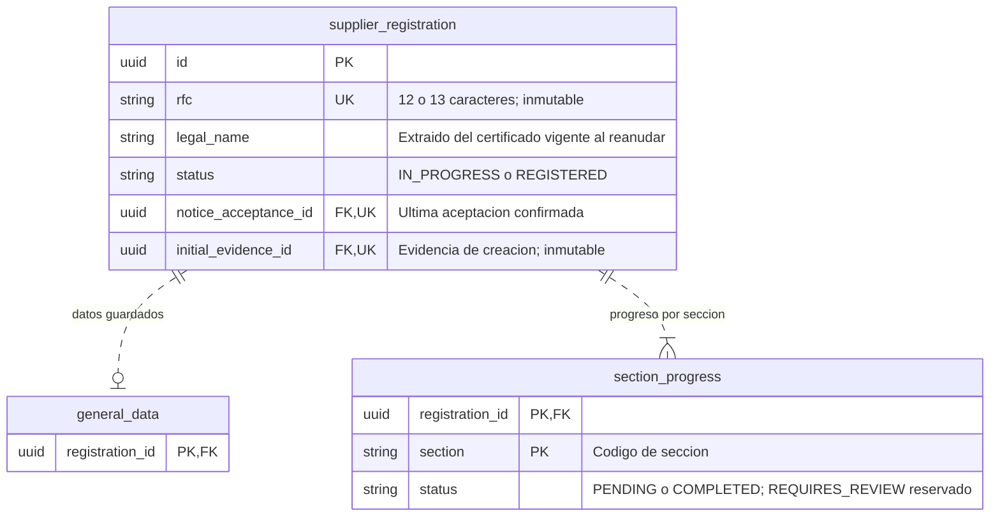
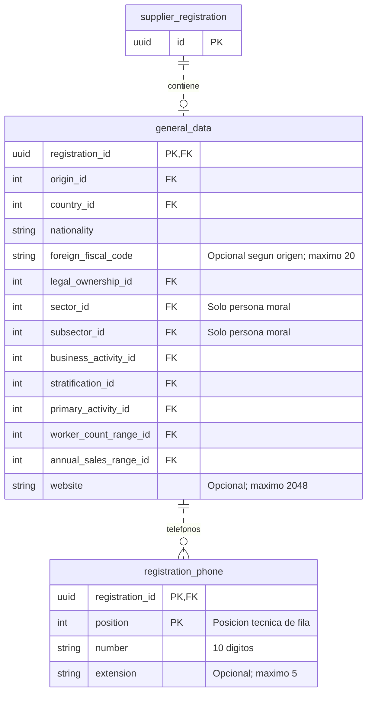
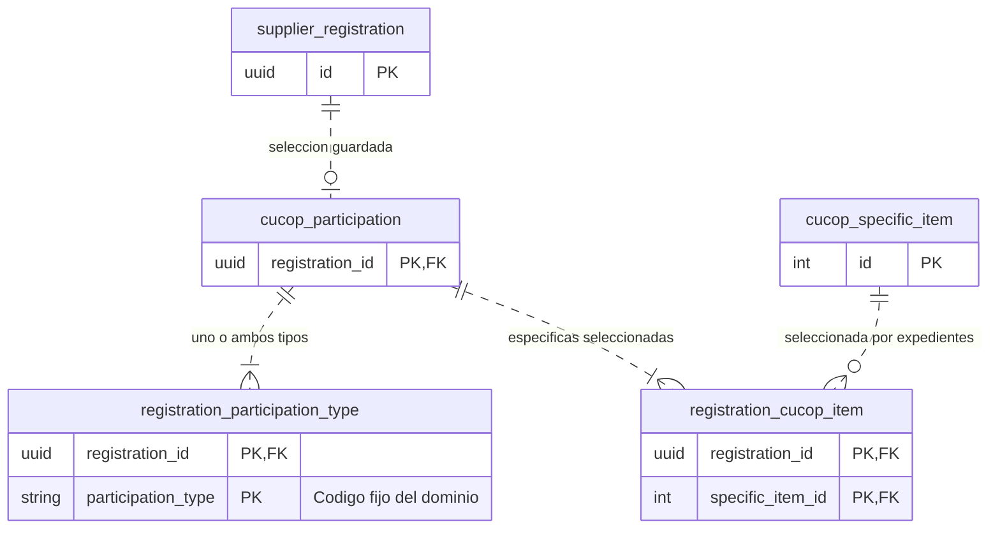
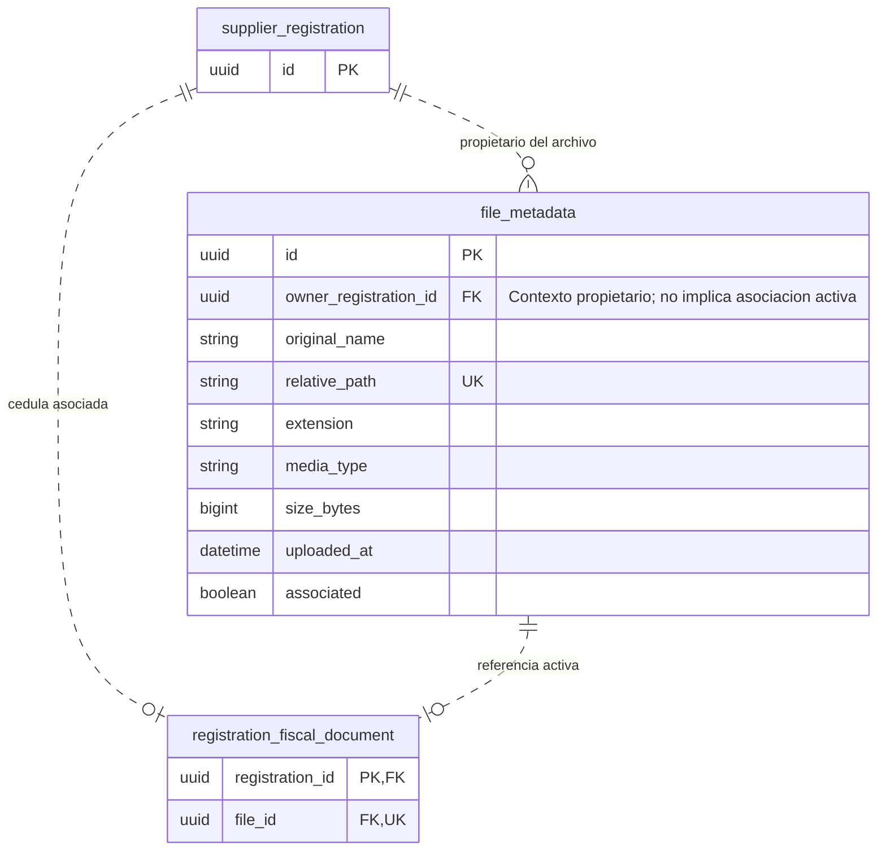
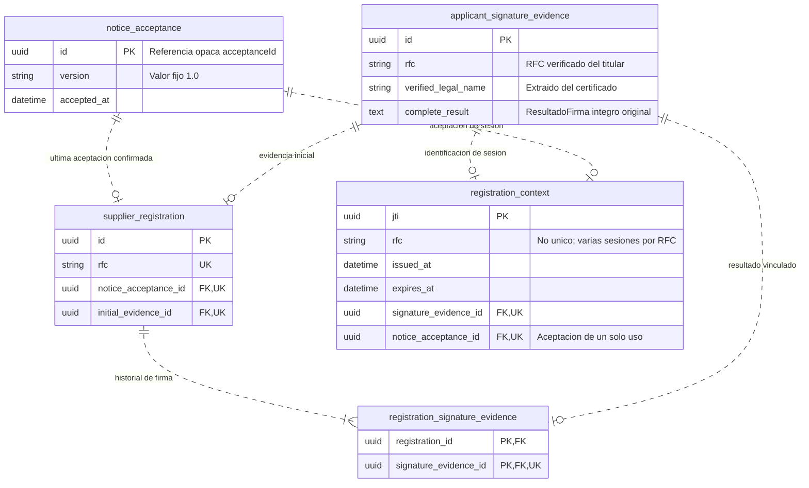

# Diseño de persistencia — Registro de proveedores

**Estado: aprobado por el usuario el 2026-10-20**, con las decisiones físicas de la
[sección 7](#7-decisiones-de-diseño-físico). Complementa el
[esquema de catálogos aprobado](catalog-database-proposal.md); no modifica sus IDs ni claves.
Todos los grupos residen en la misma base de datos. No se crean migraciones con este
documento; las relaciones representan el diseño físico de la primera etapa.

Los diagramas se separan para facilitar su lectura. Una tabla repetida conserva la misma
identidad en todos los grupos; los bloques abreviados solo muestran las claves necesarias.
`uuid`, `string`, `text`, `int`, `bigint`, `boolean` y `datetime` son tipos conceptuales; su
traducción SQL a PostgreSQL 17 está en la [sección 7](#7-decisiones-de-diseño-físico)
([ADR-0017](../adr/0017-backend-postgresql-persistencia-duradera.md), [ADR-0018](../adr/0018-backend-postgresql-en-pruebas-y-desarrollo.md)). Los instantes se representan en UTC; las
horas locales de operación se mantienen en sus requisitos.

## 1. Expediente y progreso

- Un único expediente por RFC, respaldado por constraint. El RFC no se normaliza adicionalmente.
  Régimen y Usuario se derivan de él; no se duplican como columnas editables.
- La fila de `general_data` aparece al primer guardado válido. La captura incompleta del frontend
  no se persiste en esa tabla. Iniciar o reanudar abre Datos Generales sin guardar sección visible.
- `section_progress` contiene exactamente una fila por cada una de las seis secciones del
  asistente, identificada por `(registration_id, section)`. El alta crea las seis PENDING.
  Su estado es independiente del estado global del expediente y del formulario local.
- La concurrencia sobre el agregado se controla con bloqueo pesimista de la fila de
  `supplier_registration` (ver [sección 7](#7-decisiones-de-diseño-físico)). Todas las operaciones
  que alteran datos, progreso o asociaciones del agregado, incluyendo carga y eliminación lógica,
  lo adquieren dentro de su transacción. No basta proteger cada tabla por separado.
- `REGISTERED` permite detectar registros existentes; no habilita finalización en esta etapa.
  SupplierCode y los campos de las secciones futuras quedan fuera de este esquema inicial.

## 2. Datos Generales y teléfonos

- Cada columna de catálogo referencia la PK `id` de la tabla equivalente del
  [diseño aprobado](catalog-database-proposal.md): `origin`, `country`, `legal_ownership`,
  `sector`, `subsector`, `business_activity`, `stratification`, `primary_activity`,
  `worker_count_range` y `annual_sales_range`.
- La FK comprueba existencia; no sustituye la compatibilidad origen/país/régimen, la relación
  Sector/Subsector ni vigencia cuando aplique. Se validan según RF-REG-05 y los catálogos.
- `foreign_fiscal_code` se exige para FOREIGN; Sector y Subsector se exigen para persona moral.
  No se añade un filtro de régimen a Estratificación. Nacionalidad tiene máximo 250 caracteres.
- Persona moral requiere al menos un teléfono válido; persona física no tiene filas en
  `registration_phone`. El número es texto para conservar ceros iniciales. No se exige unicidad
  del número ni se añade un límite de cantidad no definido.
- La PK de teléfonos identifica una posición técnica dentro de la colección guardada, no un
  ID expuesto por la API ni un nuevo concepto del dominio. El guardado reemplaza la colección
  completa en la transacción de Datos Generales; Eliminar teléfono es local hasta Siguiente.
- La normalización previa y el tratamiento de opcionales corresponden a ADR-0009. En BD se
  utilizan null reales para ausencia; en consultas de persona física se proyecta `phones=null`
  conforme al contrato, no una colección editable que corresponda a persona moral.

## 3. Participación y selección CUCoP

- La fila `cucop_participation` aparece al primer guardado válido; distingue la sección ausente
  de la colección de referencias. Las dos tablas hijas referencian su `registration_id`.
- Tipos permitidos: `GOODS_AND_SERVICES_SUPPLIER` y `PUBLIC_WORKS_CONTRACTOR`. La PK compuesta
  evita repetir un tipo; un check restringe sus valores. Se exige al menos uno al guardar.
- La PK de específicas evita duplicar una partida en la selección. La FK apunta exclusivamente
  a `cucop_specific_item.id`; capítulos, conceptos y genéricas no se guardan como selecciones.
- La cardinalidad mínima se valida en el guardado transaccional: una FK no obliga por sí sola
  a que existan filas hijas. Selecciones y progreso se confirman juntos.
- Los cambios en Datos Generales y la eliminación lógica de su cédula no modifican estas tablas
  ni el progreso de CUCoP.

## 4. Metadatos de archivos y asociación documental

- `file_metadata` es general: no fija PDF, cantidad ni límite para otros documentos futuros.
  La asociación de cédula en `registration_fiscal_document` sí impone máximo una por expediente;
  `file_id` único impide compartir una cédula entre expedientes. El dueño debe coincidir.
- El propietario retenido en metadatos permite identificar el contexto de carga aun después de
  desasociar. No equivale a una referencia activa de negocio ni autoriza descargar tras eliminar.
- La carga exitosa crea contenido, metadatos y asociación sin esperar Siguiente. La fila activa
  y `associated=true` se confirman juntas; UUID y ruta no se proporcionan libremente por el cliente.
- Eliminar retira la fila `registration_fiscal_document`, marca `associated=false` y cambia
  GENERAL_DATA a PENDING en una transacción de BD. Conserva el resto de los datos y CUCoP.
  No mueve ni borra bytes ni elimina la fila de metadatos durante esta operación.
- La limpieza diaria de las 02:00 en America/Mexico_City consulta los no asociados con más de
  24 horas desde `uploaded_at`. Verifica nuevamente ausencia de referencias y borra primero
  contenido, después metadatos. Un fallo conserva información suficiente para reintentar.
- Los archivos sin metadatos (p. ej., tras una compensación fallida) quedan fuera de la limpieza automática.
- Antes de añadir documentos de secciones futuras, definir sus asociaciones concretas y
  restricciones. El servicio general debe comprobar todas las referencias activas: no basta
  consultar únicamente la tabla de cédula para concluir que un archivo no está asociado.
- Índice propuesto de limpieza: `(associated, uploaded_at)`. Los bytes quedan en el volumen
  de ADR-0010, no en estas tablas. Formato, tamaño y nombre original siguen sus reglas actuales.

## 5. Evidencias, última aceptación y contexto JWT

- Aviso y evidencia pueden existir antes de crear o reanudar el expediente. No se impone una FK
  obligatoria de `registration_context.rfc` a `supplier_registration.rfc`: eso impediría identificar
  a un solicitante nuevo. Se exige correspondencia entre RFC verificado, evidencia y contexto.
- `complete_result` conserva el texto JSON del objeto `signatureResult` exactamente como se
  recibió, sin re-serializarlo: mantiene todas las propiedades, null, orden y la representación
  numérica original. No incluye llave privada ni contraseña. No se reconstruye desde columnas
  ni se convierte a un tipo numérico de precisión insuficiente.
  Las proyecciones adicionales deben concordar con [integración de firma](../api/signature-integration.md).
- El nombre verificado y el `razonSocial` original de la evidencia son datos distintos;
  reanudar actualiza `supplier_registration.legal_name` desde el certificado, sin cambiar la evidencia.
- `initial_evidence_id` referencia la evidencia de creación y debe estar también en el historial.
  La combinación de PK compuesta y unicidad de `signature_evidence_id` en el vínculo impide
  asociar un resultado a varios expedientes. Las evidencias ya vinculadas no se sobrescriben.
- El expediente conserva una sola referencia de aceptación: se reemplaza al reanudar con la última
  confirmada, sin tabla histórica de aceptaciones. Durante identificación puede existir una nueva
  aceptación del contexto mientras el expediente aún conserva la anterior hasta reanudar.
  Las aceptaciones de correlación que quedan sin referencia de contexto ni de expediente se
  conservan sin purga en la primera etapa; no constituyen historial del expediente ni se
  consultan como tal. Una purga futura requiere su
  propia decisión.
- `registration_context` guarda un registro por token emitido, no el JWT completo. Un RFC
  puede tener varias sesiones vigentes. `expires_at = issued_at + 60 minutos`; `jti` identifica
  el JWT. La inserción es transaccional y las peticiones protegidas consultan el contexto de su
  `jti` conforme a ADR-0015. `notice_acceptance_id` es único: una aceptación respalda un solo token
  y la UK resuelve también el uso concurrente de la misma aceptación. Los contextos vencidos se conservan sin purga en la primera etapa.
- Crear/reanudar vincula identidad, aceptación y evidencia exclusivamente desde contexto verificado,
  no desde referencias editables del formulario. La ausencia de contexto en la base invalida el
  uso del JWT aunque su firma y fecha de vencimiento aún sean correctas.
- Los IDs técnicos de aceptación, evidencia y `jti` se almacenan como UUID generados por el
  backend. La API los expone como texto opaco (forma canónica del UUID); el cliente no debe
  interpretar su formato y el contrato no le impone UUID.

## 6. Constraints y transacciones

| Operación | Unidad de consistencia | Coordinación |
| :--- | :--- | :--- |
| Aceptar aviso | Insertar `notice_acceptance` con versión 1.0 y `accepted_at` del backend. | Sin bloqueo: no modifica filas existentes. |
| Crear expediente | RFC único, identidad, última aceptación, evidencia inicial y vínculo histórico, seis filas de progreso. | UK de `rfc`; la violación concurrente se traduce a DUPLICATE_RFC. |
| Reanudar | Nombre verificado, última aceptación y nuevo vínculo histórico; conservar datos y progreso. | Bloqueo pesimista del expediente. |
| Guardar Datos Generales | Sustituir datos y teléfonos; validar documento asociado y confirmar GENERAL_DATA COMPLETED. | Bloqueo pesimista del expediente; serializa con carga/eliminación lógica. |
| Guardar CUCoP | Sustituir tipos y específicas y confirmar CUCOP COMPLETED; requerir Datos Generales guardados. | Bloqueo pesimista del expediente. |
| Cargar archivo | Metadatos y asociación inmediata coherentes; máximo una cédula. Compensación del contenido ante fallo según ADR-0010. | Bloqueo pesimista del expediente durante la transacción de BD. |
| Eliminar lógicamente | Retirar referencia activa, marcar metadatos no asociados y GENERAL_DATA PENDING, sin tocar bytes ni CUCoP. | Bloqueo pesimista del expediente. |
| Emitir contexto JWT | Insertar el contexto del nuevo jti tras commit, evidencia aceptada conservada; no modifica otros contextos. | PK `jti`; sin bloqueo por RFC; detalle en ADR-0015. |
| Limpieza | Exclusión frente a asociación; borrar solo no asociados elegibles, con metadatos retenidos hasta completar borrado físico. | Bloqueo pesimista de la fila de `file_metadata` al recomprobar. |

No usar borrados en cascada desde catálogo, evidencia o archivo que permitan eliminar expedientes
o información histórica fuera de las operaciones especificadas. Las restricciones entre tablas
requieren servicio transaccional y control de concurrencia, además de PK, FK y checks.
No se fija retención para expedientes o evidencias a partir de los 30 días de logs y respaldos.

## 7. Decisiones de diseño físico

Aprobadas el 2026-10-20. Nombres, organización y relaciones de los diagramas quedan
confirmados, incluidos `registration_fiscal_document` y la posición técnica de teléfonos.

### 7.1. Tipos SQL

Tipos de PostgreSQL 17. Flyway crea el esquema con estas definiciones y las entidades JPA del
adaptador de persistencia las reflejan; Hibernate solo valida (ADR-0017, ADR-0018).

| Tipo conceptual | SQL PostgreSQL | Aplicación |
| :--- | :--- | :--- |
| `uuid` | `uuid` | IDs técnicos, `jti` y referencias entre tablas del registro. |
| `string` con máximo definido | `varchar(n)` con el máximo de RF/contrato | `rfc` 13; `nationality` 250; `foreign_fiscal_code` 20; `website` 2048; `number` 10; `extension` 5. |
| `string` de código | `varchar(32)` | `status`, `section`, `participation_type`; check con los valores de `specs/domain/`. |
| `string` de versión del aviso | `varchar(3)` | `notice_acceptance.version`; check `= '1.0'`. |
| `string` sin máximo de negocio | `text` | `legal_name`, `verified_legal_name`, `original_name`, `media_type`. No crea un límite de negocio. |
| `string` técnico | `varchar(255)` | `relative_path`; `extension` usa `varchar(10)`. |
| `text` | `text` | `complete_result`: JSON original sin pérdida. |
| `int` | `integer` | FK a catálogos (IDs enteros; alinear con los tipos de catálogo al implementarlos). |
| `bigint` | `bigint` | `size_bytes`. |
| `boolean` | `boolean` | `associated`. |
| `datetime` | `timestamptz(6)`, en UTC | `accepted_at`, `issued_at`, `expires_at`, `uploaded_at`. |

Nulabilidad: PK, FK obligatorias y columnas sin anotación de opcionalidad son `NOT NULL`.
Admiten null únicamente las columnas opcionales o condicionales de Datos Generales
(`foreign_fiscal_code`, `sector_id`, `subsector_id`, `website`, y las que RF-REG-05 declare no
aplicables) y `extension` de teléfono. La obligatoriedad condicional la valida la aplicación;
la BD no la sustituye.

### 7.2. Concurrencia

Bloqueo pesimista (`SELECT ... FOR UPDATE`) de la fila de `supplier_registration` al inicio de
cada transacción que modifica el agregado. Serializa operaciones sobre el mismo expediente sin
introducir códigos de error nuevos; no existe columna `version`. La creación concurrente se
resuelve por la UK de `rfc`. Expedientes distintos no se bloquean entre sí.

### 7.3. Evidencia, aceptaciones y compensación

- Evidencia: JSON original tal cual en `complete_result` (sección 5).
- Aceptaciones sin referencia: se conservan sin purga en la primera etapa (sección 5).
- Compensación de carga: se escribe el contenido en volumen y después se confirma la
  transacción de metadatos y asociación. Si la transacción falla, se elimina el contenido
  escrito y no se informa éxito. Si esa eliminación también falla, se registra con nivel ERROR
  el UUID y la ruta relativa para reconciliación manual; el residuo queda sin metadatos y fuera
  de la limpieza automática (ADR-0010).

Fuentes: [RF](../requirements/functional.md), [modelo](domain-model.md),
[arquitectura](architecture.md), [ADR-0010](../adr/0010-backend-almacenamiento-documental-en-volumen.md),
[ADR-0015](../adr/0015-shared-token-de-registro.md) y [RNF](../requirements/no-functional.md).
