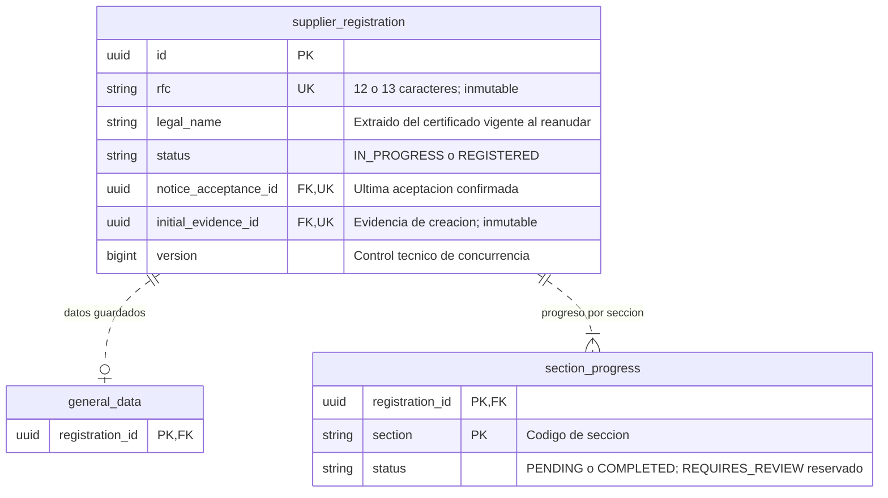
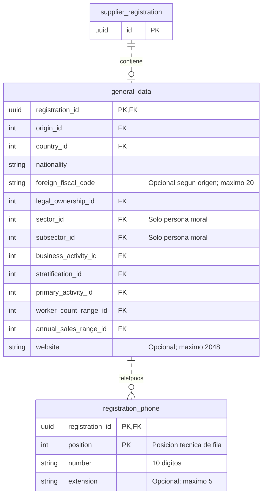
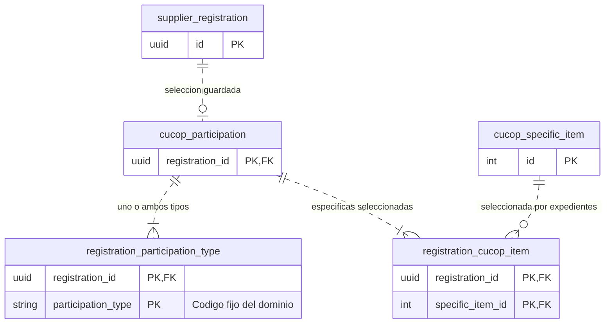
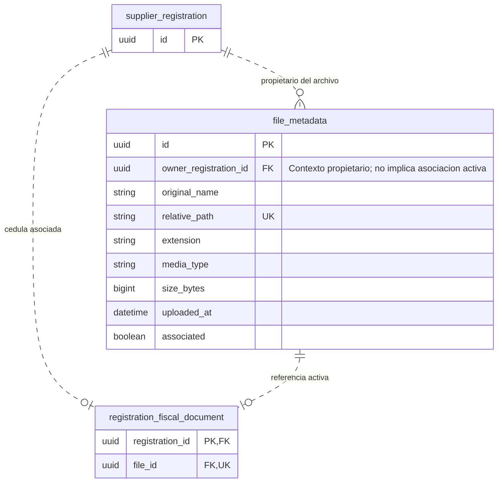
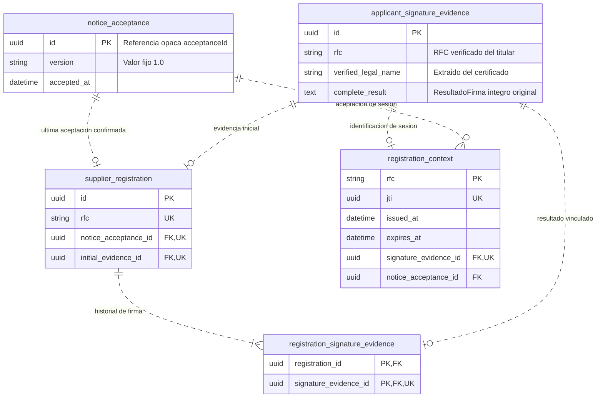

# Diseño de persistencia — Registro de proveedores

**Estado: propuesta para revisión.** Complementa el
[esquema de catálogos aprobado](catalog-database-proposal.md); no modifica sus IDs ni claves.
Todos los grupos residen en la misma base de datos. No se crean tablas ni migraciones con
este documento; las relaciones representan el diseño físico propuesto para la primera etapa.

Los diagramas se separan para facilitar su lectura. Una tabla repetida conserva la misma
identidad en todos los grupos; los bloques abreviados solo muestran las claves necesarias.
`uuid`, `string`, `int`, `bigint`, `boolean` y `datetime` son tipos conceptuales: su traducción SQL,
longitudes no definidas y motor productivo se concretarán antes de implementar. Los instantes
se representan en UTC; las horas locales de operación se mantienen en sus requisitos.

## 1. Expediente y progreso

- Un único expediente por RFC, respaldado por constraint. El RFC no se normaliza adicionalmente.
  Régimen y Usuario se derivan de él; no se duplican como columnas editables.
- La fila de `general_data` aparece al primer guardado válido. La captura incompleta del frontend
  no se persiste en esa tabla. Iniciar o reanudar abre Datos Generales sin guardar sección visible.
- `section_progress` contiene exactamente una fila por cada una de las seis secciones del
  asistente, identificada por `(registration_id, section)`. El alta crea las seis PENDING.
  Su estado es independiente del estado global del expediente y del formulario local.
- `version` es una propuesta técnica para detectar actualizaciones concurrentes; no es un
  dato de negocio. Coordinar todas las operaciones que alteran datos, progreso o asociaciones
  del agregado, incluyendo carga y eliminación lógica. No basta proteger cada tabla por separado.
- `REGISTERED` permite detectar registros existentes; no habilita finalización en esta etapa.
  SupplierCode y los campos de las secciones futuras quedan fuera de este esquema inicial.

## 2. Datos Generales y teléfonos

- Cada columna de catálogo referencia la PK `id` de la tabla equivalente del
  [diseño aprobado](catalog-database-proposal.md): `origin`, `country`, `legal_ownership`,
  `sector`, `subsector`, `business_activity`, `stratification`, `primary_activity`,
  `worker_count_range` y `annual_sales_range`.
- La FK comprueba existencia; no sustituye la compatibilidad origen/país/régimen, la relación
  Sector/Subsector ni vigencia cuando aplique. Se validan según RF-REG-05 y los catálogos.
- `foreign_fiscal_code` se exige para FOREIGN; Sector y Subsector se exigen para persona moral.
  No se añade un filtro de régimen a Estratificación. Nacionalidad tiene máximo 250 caracteres.
- Persona moral requiere al menos un teléfono válido; persona física no tiene filas en
  `registration_phone`. El número es texto para conservar ceros iniciales. No se exige unicidad
  del número ni se añade un límite de cantidad no definido.
- La PK de teléfonos identifica una posición técnica dentro de la colección guardada, no un
  ID expuesto por la API ni un nuevo concepto del dominio. El guardado reemplaza la colección
  completa en la transacción de Datos Generales; Eliminar teléfono es local hasta Siguiente.
- La normalización previa y el tratamiento de opcionales corresponden a ADR-0009. En BD se
  utilizan null reales para ausencia; en consultas de persona física se proyecta `phones=null`
  conforme al contrato, no una colección editable que corresponda a persona moral.

## 3. Participación y selección CUCoP

- La fila `cucop_participation` aparece al primer guardado válido; distingue la sección ausente
  de la colección de referencias. Las dos tablas hijas referencian su `registration_id`.
- Tipos permitidos: `GOODS_AND_SERVICES_SUPPLIER` y `PUBLIC_WORKS_CONTRACTOR`. La PK compuesta
  evita repetir un tipo; un check restringe sus valores. Se exige al menos uno al guardar.
- La PK de específicas evita duplicar una partida en la selección. La FK apunta exclusivamente
  a `cucop_specific_item.id`; capítulos, conceptos y genéricas no se guardan como selecciones.
- La cardinalidad mínima se valida en el guardado transaccional: una FK no obliga por sí sola
  a que existan filas hijas. Selecciones y progreso se confirman juntos.
- Los cambios en Datos Generales y la eliminación lógica de su cédula no modifican estas tablas
  ni el progreso de CUCoP.

## 4. Metadatos de archivos y asociación documental

- `file_metadata` es general: no fija PDF, cantidad ni límite para otros documentos futuros.
  La asociación de cédula en `registration_fiscal_document` sí impone máximo una por expediente;
  `file_id` único impide compartir una cédula entre expedientes. El dueño debe coincidir.
- El propietario retenido en metadatos permite identificar el contexto de carga aun después de
  desasociar. No equivale a una referencia activa de negocio ni autoriza descargar tras eliminar.
- La carga exitosa crea contenido, metadatos y asociación sin esperar Siguiente. La fila activa
  y `associated=true` se confirman juntas; UUID y ruta no se proporcionan libremente por el cliente.
- Eliminar retira la fila `registration_fiscal_document`, marca `associated=false` y cambia
  GENERAL_DATA a PENDING en una transacción de BD. Conserva el resto de los datos y CUCoP.
  No mueve ni borra bytes ni elimina la fila de metadatos durante esta operación.
- La limpieza diaria de las 02:00 en America/Mexico_City consulta los no asociados con más de
  24 horas desde `uploaded_at`. Verifica nuevamente ausencia de referencias y borra primero
  contenido, después metadatos. Un fallo conserva información suficiente para reintentar.
- Los archivos sin metadatos tras reiniciar H2 quedan fuera de la limpieza automática.
- Antes de añadir documentos de secciones futuras, definir sus asociaciones concretas y
  restricciones. El servicio general debe comprobar todas las referencias activas: no basta
  consultar únicamente la tabla de cédula para concluir que un archivo no está asociado.
- Índice propuesto de limpieza: `(associated, uploaded_at)`. Los bytes quedan en el volumen
  de ADR-0010, no en estas tablas. Formato, tamaño y nombre original siguen sus reglas actuales.

## 5. Evidencias, última aceptación y contexto JWT

- Aviso y evidencia pueden existir antes de crear o reanudar el expediente. No se impone una FK
  obligatoria de `registration_context.rfc` a `supplier_registration.rfc`: eso impediría identificar
  a un solicitante nuevo. Se exige correspondencia entre RFC verificado, evidencia y contexto.
- `complete_result` conserva todas las propiedades y valores recibidos, incluidos null y datos
  numéricos, sin llave privada ni contraseña. `text` representa almacenamiento sin pérdida;
  no prescribe reconstruirlo desde unas pocas columnas ni usar un tipo numérico de precisión insuficiente.
  Las proyecciones adicionales deben concordar con [integración de firma](../api/signature-integration.md).
- El nombre verificado y el `razonSocial` original de la evidencia son datos distintos;
  reanudar actualiza `supplier_registration.legal_name` desde el certificado, sin cambiar la evidencia.
- `initial_evidence_id` referencia la evidencia de creación y debe estar también en el historial.
  La combinación de PK compuesta y unicidad de `signature_evidence_id` en el vínculo impide
  asociar un resultado a varios expedientes. Las evidencias ya vinculadas no se sobrescriben.
- El expediente conserva una sola referencia de aceptación: se reemplaza al reanudar con la última
  confirmada, sin tabla histórica de aceptaciones. Durante identificación puede existir una nueva
  aceptación del contexto mientras el expediente aún conserva la anterior hasta reanudar.
  Gestionar las aceptaciones de correlación que quedan sin referencia sin convertirlas en historial;
  no se fija aquí un plazo de conservación de intentos inconclusos.
- `registration_context` guarda una sola sesión por RFC, no un historial ni el JWT completo.
  `expires_at = issued_at + 60 minutos`; `jti` identifica el JWT vigente. La sustitución es
  transaccional y las peticiones protegidas consultan ese contexto conforme a ADR-0015.
- Crear/reanudar vincula identidad, aceptación y evidencia exclusivamente desde contexto verificado,
  no desde referencias editables del formulario. La ausencia de contexto después de reiniciar H2
  invalida el uso del JWT aunque su firma y fecha de vencimiento aún sean correctas.
- Se propone UUID como almacenamiento de IDs técnicos de aceptación y evidencia y `jti`;
  no se impone formato UUID a referencias API que están declaradas simplemente opacas.

## 6. Constraints y transacciones por confirmar en el diseño físico

| Operación | Unidad de consistencia |
| :--- | :--- |
| Crear expediente | RFC único, identidad, última aceptación, evidencia inicial y vínculo histórico, seis filas de progreso. |
| Reanudar | Nombre verificado, última aceptación y nuevo vínculo histórico; conservar datos y progreso. |
| Guardar Datos Generales | Sustituir datos y teléfonos; validar documento asociado y confirmar GENERAL_DATA COMPLETED. Coordinar con carga/eliminación lógica concurrentes. |
| Guardar CUCoP | Sustituir tipos y específicas y confirmar CUCOP COMPLETED; requerir Datos Generales guardados. |
| Cargar archivo | Contenido y asociación inmediata coherentes; máximo una cédula, compensación ante fallo según ADR-0010. |
| Eliminar lógicamente | Retirar referencia activa, marcar metadatos no asociados y GENERAL_DATA PENDING, sin tocar bytes ni CUCoP. |
| Emitir contexto JWT | Sustitución serializada por RFC; un jti vigente tras commit, evidencia aceptada conservada. |
| Limpieza | Exclusión frente a asociación; borrar solo no asociados elegibles, con metadatos retenidos hasta completar borrado físico. |

No usar borrados en cascada desde catálogo, evidencia o archivo que permitan eliminar expedientes
o información histórica fuera de las operaciones especificadas. Las restricciones entre tablas
requieren servicio transaccional y control de concurrencia, además de PK, FK y checks.
No se fija retención para expedientes o evidencias a partir de los 30 días de logs y respaldos.

## 7. Revisión pendiente

- Confirmar nombres y organización de estas tablas, incluyendo el vínculo documental específico
  y la identificación por posición de teléfonos.
- Fijar tipos SQL, nullabilidad condicional, longitudes no especificadas y estrategia de bloqueo/versionado.
- Alinear la representación de evidencia íntegra y los IDs opacos con el generador y adaptadores,
  sin pérdida de datos ni cambio del contrato por conveniencia de persistencia.
- Concretar el tratamiento de aceptaciones de correlación sin referencias y de compensaciones
  de carga fallidas. Estas precisiones no habilitan borrado de evidencias históricas.

Fuentes: [RF](../requirements/functional.md), [modelo](domain-model.md),
[arquitectura](architecture.md), [ADR-0010](../adr/0010-backend-almacenamiento-documental-en-volumen.md),
[ADR-0015](../adr/0015-shared-token-de-registro.md) y [RNF](../requirements/no-functional.md).
